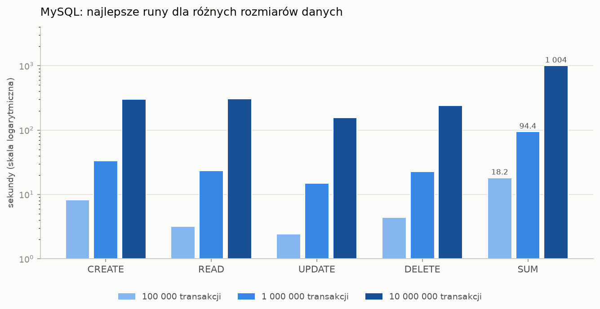
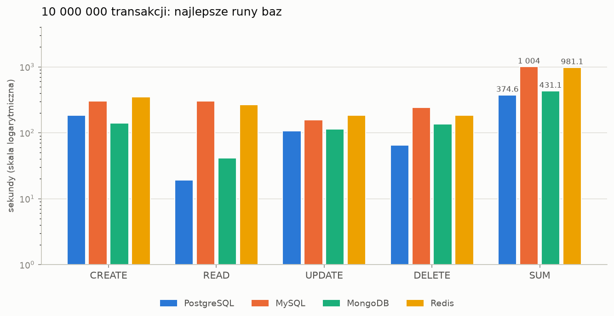
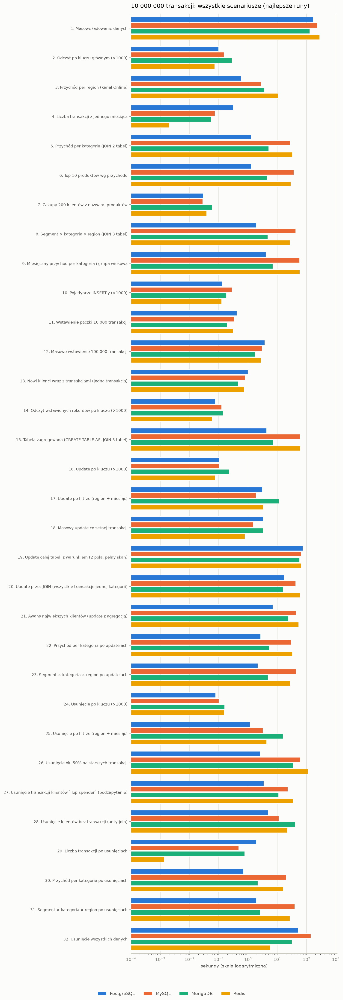
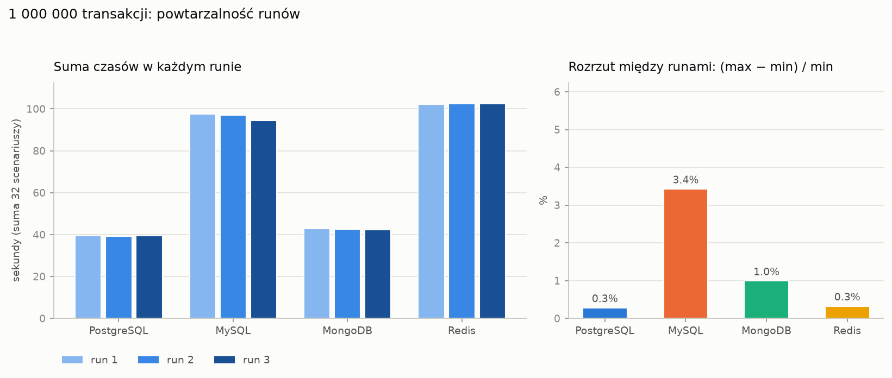

# Wyniki benchmarku

Źródło: `runs.csv`. Czasy w sekundach. R1–R3 to kolejne runy, `best*` to najlepszy run (kompletny run z najmniejszą sumą czasów wszystkich 32 scenariuszy; jeśli żaden run nie był kompletny, run z największą liczbą udanych scenariuszy). Tekst zamiast liczby oznacza, że scenariusz się nie udał: `timeout`, `oom`, `error` albo `skipped` (pominięty, bo wcześniejsza modyfikacja danych się nie udała); `DNF` w wierszu SUMA oznacza, że run nie został ukończony. Na wykresach krzyżyk (×) przy osi oznacza scenariusz, który się nie udał, z jego statusem. Skala wykresów jest logarytmiczna. Opis scenariuszy: [SCENARIOS.md](../../SCENARIOS.md).

## Tabele per baza

### PostgreSQL

| Operacja | 100k R1 | 100k R2 | 100k R3 | 100k best* | 1M R1 | 1M R2 | 1M R3 | 1M best* | 10M R1 | 10M R2 | 10M R3 | 10M best* |
|---|---:|---:|---:|---:|---:|---:|---:|---:|---:|---:|---:|---:|
| CREATE (6) | 6.81 | 7.09 | 7.02 | **7.02** | 21.0 | 20.9 | 20.8 | **20.9** | 184.3 | 186.3 | 186.8 | **184.3** |
| READ (14) | 0.58 | 0.58 | 0.63 | **0.63** | 1.59 | 1.62 | 1.63 | **1.62** | 19.3 | 19.8 | 19.6 | **19.3** |
| UPDATE (6) | 1.90 | 1.60 | 1.59 | **1.59** | 10.4 | 10.4 | 10.5 | **10.4** | 106.5 | 107.1 | 106.5 | **106.5** |
| DELETE (6) | 1.41 | 1.39 | 1.40 | **1.40** | 6.31 | 6.32 | 6.47 | **6.32** | 64.5 | 67.1 | 65.4 | **64.5** |
| **SUMA (32)** | 10.7 | 10.7 | 10.6 | **10.6** | 39.3 | 39.2 | 39.3 | **39.2** | 374.6 | 380.3 | 378.3 | **374.6** |

### MySQL

| Operacja | 100k R1 | 100k R2 | 100k R3 | 100k best* | 1M R1 | 1M R2 | 1M R3 | 1M best* | 10M R1 | 10M R2 | 10M R3 | 10M best* |
|---|---:|---:|---:|---:|---:|---:|---:|---:|---:|---:|---:|---:|
| CREATE (6) | 8.33 | 8.64 | 8.20 | **8.20** | 35.3 | 34.6 | 33.5 | **33.5** | 320.7 | 302.1 | 334.6 | **302.1** |
| READ (14) | 3.17 | 3.22 | 3.21 | **3.21** | 23.0 | 23.2 | 23.3 | **23.3** | 312.0 | 304.3 | 305.5 | **304.3** |
| UPDATE (6) | 2.46 | 2.46 | 2.42 | **2.42** | 16.3 | 16.5 | 15.0 | **15.0** | 162.7 | 156.5 | 156.6 | **156.5** |
| DELETE (6) | 4.39 | 4.30 | 4.38 | **4.38** | 23.0 | 22.8 | 22.6 | **22.6** | 244.6 | 241.1 | 240.0 | **241.1** |
| **SUMA (32)** | 18.4 | 18.6 | 18.2 | **18.2** | 97.6 | 97.1 | 94.4 | **94.4** | 1 040 | 1 004 | 1 037 | **1 004** |

### MongoDB

| Operacja | 100k R1 | 100k R2 | 100k R3 | 100k best* | 1M R1 | 1M R2 | 1M R3 | 1M best* | 10M R1 | 10M R2 | 10M R3 | 10M best* |
|---|---:|---:|---:|---:|---:|---:|---:|---:|---:|---:|---:|---:|
| CREATE (6) | 4.24 | 4.29 | 4.22 | **4.22** | 15.5 | 15.4 | 15.4 | **15.4** | 140.0 | 141.7 | 141.8 | **140.0** |
| READ (14) | 1.08 | 1.11 | 1.05 | **1.05** | 4.04 | 4.01 | 4.02 | **4.02** | 41.6 | 42.0 | 41.9 | **41.6** |
| UPDATE (6) | 1.70 | 1.69 | 1.66 | **1.66** | 10.7 | 10.7 | 10.7 | **10.7** | 113.5 | 113.1 | 114.0 | **113.5** |
| DELETE (6) | 2.55 | 2.44 | 2.53 | **2.53** | 12.6 | 12.3 | 12.2 | **12.2** | 136.0 | 153.9 | 138.4 | **136.0** |
| **SUMA (32)** | 9.57 | 9.54 | 9.47 | **9.47** | 42.8 | 42.5 | 42.4 | **42.4** | 431.1 | 450.7 | 436.1 | **431.1** |

### Redis

| Operacja | 100k R1 | 100k R2 | 100k R3 | 100k best* | 1M R1 | 1M R2 | 1M R3 | 1M best* | 10M R1 | 10M R2 | 10M R3 | 10M best* |
|---|---:|---:|---:|---:|---:|---:|---:|---:|---:|---:|---:|---:|
| CREATE (6) | 8.23 | 7.62 | 7.83 | **7.62** | 37.2 | 37.3 | 37.3 | **37.2** | 348.3 | 354.4 | 350.4 | **348.3** |
| READ (14) | 3.98 | 3.68 | 3.75 | **3.68** | 26.2 | 26.2 | 26.3 | **26.2** | 265.6 | 263.5 | 267.0 | **265.6** |
| UPDATE (6) | 3.77 | 3.08 | 3.05 | **3.08** | 18.7 | 18.8 | 18.8 | **18.7** | 184.5 | 183.0 | 185.1 | **184.5** |
| DELETE (6) | 4.68 | 4.55 | 4.54 | **4.55** | 19.9 | 20.0 | 20.0 | **19.9** | 182.7 | 183.1 | 184.2 | **182.7** |
| **SUMA (32)** | 20.7 | 18.9 | 19.2 | **18.9** | 102.1 | 102.3 | 102.4 | **102.1** | 981.1 | 984.1 | 986.7 | **981.1** |

## Porównanie baz (najlepsze runy)

### 100 000 transakcji

| Operacja | PostgreSQL | MySQL | MongoDB | Redis |
|---|---:|---:|---:|---:|
| CREATE (6) | 7.02 | 8.20 | **4.22** | 7.62 |
| READ (14) | **0.63** | 3.21 | 1.05 | 3.68 |
| UPDATE (6) | **1.59** | 2.42 | 1.66 | 3.08 |
| DELETE (6) | **1.40** | 4.38 | 2.53 | 4.55 |
| **SUMA (32)** | 10.6 | 18.2 | **9.47** | 18.9 |
| najlepszy run | run 3 | run 3 | run 3 | run 2 |

Wszystkie 32 scenariusze

| # | Scenariusz | Op. | Trudność | PostgreSQL | MySQL | MongoDB | Redis |
|---|---:|---:|---:|---:|---:|---:|---:|
| 1 | Masowe ładowanie danych | CREATE | heavy | 1.89 | 2.99 | **1.37** | 2.74 |
| 2 | Odczyt po kluczu głównym (×1000) | READ | easy | 0.12 | 0.14 | 0.14 | **0.06** |
| 3 | Przychód per region (kanał Online) | READ | easy | **0.01** | 0.06 | 0.04 | 0.11 |
| 4 | Liczba transakcji z jednego miesiąca | READ | easy | 0.00 | **0.00** | 0.01 | 0.00 |
| 5 | Przychód per kategoria (JOIN 2 tabel) | READ | medium | **0.03** | 0.21 | 0.05 | 0.32 |
| 6 | Top 10 produktów wg przychodu | READ | medium | **0.03** | 0.22 | 0.08 | 0.27 |
| 7 | Zakupy 200 klientów z nazwami produktów | READ | medium | **0.02** | 0.03 | 0.05 | 0.03 |
| 8 | Segment × kategoria × region (JOIN 3 tabel) | READ | heavy | **0.04** | 0.20 | 0.05 | 0.22 |
| 9 | Miesięczny przychód per kategoria i grupa wiekowa | READ | heavy | 0.07 | 0.45 | **0.07** | 0.48 |
| 10 | Pojedyncze INSERT-y (×1000) | CREATE | easy | **0.10** | 0.14 | 0.15 | 0.11 |
| 11 | Wstawienie paczki 10 000 transakcji | CREATE | medium | 0.39 | 0.32 | **0.20** | 0.29 |
| 12 | Masowe wstawienie 100 000 transakcji | CREATE | heavy | 3.52 | 2.89 | **1.84** | 2.60 |
| 13 | Nowi klienci wraz z transakcjami (jedna transakcja) | CREATE | heavy | 0.94 | 0.77 | **0.49** | 0.69 |
| 14 | Odczyt wstawionych rekordów po kluczu (×1000) | READ | easy | 0.07 | 0.14 | 0.14 | **0.07** |
| 15 | Tabela zagregowana (CREATE TABLE AS, JOIN 3 tabel) | CREATE | heavy | 0.18 | 1.08 | **0.17** | 1.18 |
| 16 | Update po kluczu (×1000) | UPDATE | easy | 0.09 | 0.09 | 0.14 | **0.08** |
| 17 | Update po filtrze (region + miesiąc) | UPDATE | medium | 0.04 | 0.05 | **0.04** | 0.23 |
| 18 | Masowy update co setnej transakcji | UPDATE | heavy | 0.03 | 0.02 | 0.02 | **0.01** |
| 19 | Update całej tabeli z warunkiem (2 pola, pełny skan) | UPDATE | heavy | 0.75 | 0.66 | 0.62 | **0.59** |
| 20 | Update przez JOIN (wszystkie transakcje jednej kategorii) | UPDATE | heavy | 0.46 | 0.81 | **0.37** | 1.14 |
| 21 | Awans największych klientów (update z agregacją) | UPDATE | heavy | **0.22** | 0.80 | 0.48 | 1.03 |
| 22 | Przychód per kategoria po update'ach | READ | medium | **0.05** | 0.54 | 0.12 | 0.72 |
| 23 | Segment × kategoria × region po update'ach | READ | heavy | **0.06** | 0.48 | 0.11 | 0.52 |
| 24 | Usunięcie po kluczu (×1000) | DELETE | easy | **0.05** | 0.09 | 0.13 | 0.15 |
| 25 | Usunięcie po filtrze (region + miesiąc) | DELETE | medium | **0.01** | 0.09 | 0.05 | 0.26 |
| 26 | Usunięcie ok. 50% najstarszych transakcji | DELETE | heavy | **0.07** | 1.13 | 0.76 | 2.69 |
| 27 | Usunięcie transakcji klientów `Top spender` (podzapytanie) | DELETE | heavy | **0.13** | 0.55 | 0.34 | 1.09 |
| 28 | Usunięcie klientów bez transakcji (anty-join) | DELETE | heavy | **0.07** | 0.17 | 0.52 | 0.29 |
| 29 | Liczba transakcji po usunięciach | READ | easy | 0.02 | 0.01 | 0.04 | **0.00** |
| 30 | Przychód per kategoria po usunięciach | READ | medium | **0.03** | 0.22 | 0.07 | 0.37 |
| 31 | Segment × kategoria × region po usunięciach | READ | heavy | **0.06** | 0.52 | 0.09 | 0.50 |
| 32 | Usunięcie wszystkich danych | DELETE | heavy | 1.07 | 2.35 | 0.73 | **0.07** |

### 1 000 000 transakcji

| Operacja | PostgreSQL | MySQL | MongoDB | Redis |
|---|---:|---:|---:|---:|
| CREATE (6) | 20.9 | 33.5 | **15.4** | 37.2 |
| READ (14) | **1.62** | 23.3 | 4.02 | 26.2 |
| UPDATE (6) | **10.4** | 15.0 | 10.7 | 18.7 |
| DELETE (6) | **6.32** | 22.6 | 12.2 | 19.9 |
| **SUMA (32)** | **39.2** | 94.4 | 42.4 | 102.1 |
| najlepszy run | run 2 | run 3 | run 3 | run 1 |

Wszystkie 32 scenariusze

| # | Scenariusz | Op. | Trudność | PostgreSQL | MySQL | MongoDB | Redis |
|---|---:|---:|---:|---:|---:|---:|---:|
| 1 | Masowe ładowanie danych | CREATE | heavy | 15.5 | 24.0 | **11.9** | 26.9 |
| 2 | Odczyt po kluczu głównym (×1000) | READ | easy | 0.07 | 0.13 | 0.15 | **0.06** |
| 3 | Przychód per region (kanał Online) | READ | easy | **0.06** | 0.28 | 0.27 | 1.03 |
| 4 | Liczba transakcji z jednego miesiąca | READ | easy | 0.02 | 0.01 | 0.02 | **0.00** |
| 5 | Przychód per kategoria (JOIN 2 tabel) | READ | medium | **0.12** | 2.68 | 0.39 | 3.16 |
| 6 | Top 10 produktów wg przychodu | READ | medium | **0.13** | 2.78 | 0.35 | 2.73 |
| 7 | Zakupy 200 klientów z nazwami produktów | READ | medium | **0.02** | 0.03 | 0.05 | 0.04 |
| 8 | Segment × kategoria × region (JOIN 3 tabel) | READ | heavy | **0.16** | 2.11 | 0.37 | 2.57 |
| 9 | Miesięczny przychód per kategoria i grupa wiekowa | READ | heavy | **0.33** | 4.68 | 0.65 | 5.48 |
| 10 | Pojedyncze INSERT-y (×1000) | CREATE | easy | **0.10** | 0.17 | 0.16 | 0.11 |
| 11 | Wstawienie paczki 10 000 transakcji | CREATE | medium | 0.40 | 0.31 | **0.21** | 0.30 |
| 12 | Masowe wstawienie 100 000 transakcji | CREATE | heavy | 3.57 | 2.79 | **1.85** | 2.72 |
| 13 | Nowi klienci wraz z transakcjami (jedna transakcja) | CREATE | heavy | 0.95 | 0.74 | **0.49** | 0.73 |
| 14 | Odczyt wstawionych rekordów po kluczu (×1000) | READ | easy | **0.06** | 0.15 | 0.13 | 0.07 |
| 15 | Tabela zagregowana (CREATE TABLE AS, JOIN 3 tabel) | CREATE | heavy | **0.38** | 5.48 | 0.76 | 6.42 |
| 16 | Update po kluczu (×1000) | UPDATE | easy | 0.10 | 0.10 | 0.13 | **0.07** |
| 17 | Update po filtrze (region + miesiąc) | UPDATE | medium | 0.18 | 0.25 | **0.13** | 0.43 |
| 18 | Masowy update co setnej transakcji | UPDATE | heavy | 0.16 | 0.15 | 0.09 | **0.08** |
| 19 | Update całej tabeli z warunkiem (2 pola, pełny skan) | UPDATE | heavy | 7.36 | 6.32 | **5.96** | 6.33 |
| 20 | Update przez JOIN (wszystkie transakcje jednej kategorii) | UPDATE | heavy | 1.92 | 4.04 | **1.73** | 6.23 |
| 21 | Awans największych klientów (update z agregacją) | UPDATE | heavy | **0.71** | 4.10 | 2.70 | 5.61 |
| 22 | Przychód per kategoria po update'ach | READ | medium | **0.15** | 3.20 | 0.53 | 3.56 |
| 23 | Segment × kategoria × region po update'ach | READ | heavy | **0.18** | 2.46 | 0.45 | 2.90 |
| 24 | Usunięcie po kluczu (×1000) | DELETE | easy | **0.06** | 0.10 | 0.15 | 0.15 |
| 25 | Usunięcie po filtrze (region + miesiąc) | DELETE | medium | **0.03** | 0.34 | 0.15 | 0.48 |
| 26 | Usunięcie ok. 50% najstarszych transakcji | DELETE | heavy | **0.25** | 6.33 | 3.31 | 12.5 |
| 27 | Usunięcie transakcji klientów `Top spender` (podzapytanie) | DELETE | heavy | **0.35** | 2.43 | 1.15 | 4.06 |
| 28 | Usunięcie klientów bez transakcji (anty-join) | DELETE | heavy | **0.51** | 1.18 | 4.24 | 2.31 |
| 29 | Liczba transakcji po usunięciach | READ | easy | 0.05 | 0.06 | 0.11 | **0.00** |
| 30 | Przychód per kategoria po usunięciach | READ | medium | **0.08** | 1.95 | 0.24 | 1.76 |
| 31 | Segment × kategoria × region po usunięciach | READ | heavy | **0.17** | 2.75 | 0.30 | 2.85 |
| 32 | Usunięcie wszystkich danych | DELETE | heavy | 5.12 | 12.2 | 3.23 | **0.38** |

### 10 000 000 transakcji

| Operacja | PostgreSQL | MySQL | MongoDB | Redis |
|---|---:|---:|---:|---:|
| CREATE (6) | 184.3 | 302.1 | **140.0** | 348.3 |
| READ (14) | **19.3** | 304.3 | 41.6 | 265.6 |
| UPDATE (6) | **106.5** | 156.5 | 113.5 | 184.5 |
| DELETE (6) | **64.5** | 241.1 | 136.0 | 182.7 |
| **SUMA (32)** | **374.6** | 1 004 | 431.1 | 981.1 |
| najlepszy run | run 1 | run 2 | run 1 | run 1 |

Wszystkie 32 scenariusze

| # | Scenariusz | Op. | Trudność | PostgreSQL | MySQL | MongoDB | Redis |
|---|---:|---:|---:|---:|---:|---:|---:|
| 1 | Masowe ładowanie danych | CREATE | heavy | 174.7 | 237.3 | **130.1** | 282.5 |
| 2 | Odczyt po kluczu głównym (×1000) | READ | easy | 0.10 | 0.15 | 0.29 | **0.07** |
| 3 | Przychód per region (kanał Online) | READ | easy | **0.57** | 2.82 | 3.72 | 11.0 |
| 4 | Liczba transakcji z jednego miesiąca | READ | easy | 0.32 | 0.07 | 0.06 | **0.00** |
| 5 | Przychód per kategoria (JOIN 2 tabel) | READ | medium | **1.30** | 28.3 | 5.13 | 33.1 |
| 6 | Top 10 produktów wg przychodu | READ | medium | **1.32** | 37.2 | 4.48 | 29.2 |
| 7 | Zakupy 200 klientów z nazwami produktów | READ | medium | 0.03 | **0.03** | 0.06 | 0.04 |
| 8 | Segment × kategoria × region (JOIN 3 tabel) | READ | heavy | **1.96** | 43.0 | 4.79 | 27.5 |
| 9 | Miesięczny przychód per kategoria i grupa wiekowa | READ | heavy | **4.14** | 57.8 | 7.05 | 59.3 |
| 10 | Pojedyncze INSERT-y (×1000) | CREATE | easy | 0.13 | 0.29 | 0.18 | **0.12** |
| 11 | Wstawienie paczki 10 000 transakcji | CREATE | medium | 0.42 | 0.33 | **0.19** | 0.31 |
| 12 | Masowe wstawienie 100 000 transakcji | CREATE | heavy | 3.74 | 3.00 | **1.75** | 2.80 |
| 13 | Nowi klienci wraz z transakcjami (jedna transakcja) | CREATE | heavy | 1.00 | 0.80 | **0.47** | 0.75 |
| 14 | Odczyt wstawionych rekordów po kluczu (×1000) | READ | easy | 0.08 | 0.13 | 0.14 | **0.06** |
| 15 | Tabela zagregowana (CREATE TABLE AS, JOIN 3 tabel) | CREATE | heavy | **4.32** | 60.4 | 7.36 | 61.9 |
| 16 | Update po kluczu (×1000) | UPDATE | easy | 0.11 | 0.10 | 0.23 | **0.08** |
| 17 | Update po filtrze (region + miesiąc) | UPDATE | medium | 3.12 | **1.89** | 11.5 | 3.38 |
| 18 | Masowy update co setnej transakcji | UPDATE | heavy | 3.37 | 1.54 | 3.32 | **0.79** |
| 19 | Update całej tabeli z warunkiem (2 pola, pełny skan) | UPDATE | heavy | 75.1 | 65.8 | **58.3** | 66.1 |
| 20 | Update przez JOIN (wszystkie transakcje jednej kategorii) | UPDATE | heavy | 17.7 | 42.8 | **15.7** | 60.1 |
| 21 | Awans największych klientów (update z agregacją) | UPDATE | heavy | **7.10** | 44.4 | 24.4 | 54.1 |
| 22 | Przychód per kategoria po update'ach | READ | medium | **2.72** | 30.2 | 5.43 | 33.5 |
| 23 | Segment × kategoria × region po update'ach | READ | heavy | **2.17** | 44.2 | 4.82 | 28.1 |
| 24 | Usunięcie po kluczu (×1000) | DELETE | easy | **0.08** | 0.10 | 0.16 | 0.16 |
| 25 | Usunięcie po filtrze (region + miesiąc) | DELETE | medium | **1.18** | 3.26 | 15.8 | 4.37 |
| 26 | Usunięcie ok. 50% najstarszych transakcji | DELETE | heavy | **2.68** | 62.0 | 35.2 | 114.8 |
| 27 | Usunięcie transakcji klientów `Top spender` (podzapytanie) | DELETE | heavy | **3.50** | 23.0 | 11.2 | 35.1 |
| 28 | Usunięcie klientów bez transakcji (anty-join) | DELETE | heavy | **4.91** | 11.3 | 41.8 | 22.4 |
| 29 | Liczba transakcji po usunięciach | READ | easy | 1.97 | 0.48 | 0.78 | **0.00** |
| 30 | Przychód per kategoria po usunięciach | READ | medium | **0.71** | 20.2 | 2.17 | 16.5 |
| 31 | Segment × kategoria × region po usunięciach | READ | heavy | **1.95** | 39.7 | 2.67 | 27.2 |
| 32 | Usunięcie wszystkich danych | DELETE | heavy | 52.2 | 141.5 | 31.9 | **5.85** |

## Powtarzalność runów

Suma czasów wszystkich 32 scenariuszy w każdym runie (sekundy) i rozrzut między kompletnymi runami: (największy − najmniejszy) / najmniejszy. Mały rozrzut znaczy, że różnice między bazami są większe niż szum pomiaru.

### 100 000 transakcji

| Baza | run 1 | run 2 | run 3 | rozrzut |
|---|---:|---:|---:|---:|
| PostgreSQL | 10.7 | 10.7 | 10.6 | 0% |
| MySQL | 18.4 | 18.6 | 18.2 | 2% |
| MongoDB | 9.57 | 9.54 | 9.47 | 1% |
| Redis | 20.7 | 18.9 | 19.2 | 9% |

### 1 000 000 transakcji

| Baza | run 1 | run 2 | run 3 | rozrzut |
|---|---:|---:|---:|---:|
| PostgreSQL | 39.3 | 39.2 | 39.3 | 0% |
| MySQL | 97.6 | 97.1 | 94.4 | 3% |
| MongoDB | 42.8 | 42.5 | 42.4 | 1% |
| Redis | 102.1 | 102.3 | 102.4 | 0% |

### 10 000 000 transakcji

| Baza | run 1 | run 2 | run 3 | rozrzut |
|---|---:|---:|---:|---:|
| PostgreSQL | 374.6 | 380.3 | 378.3 | 2% |
| MySQL | 1 040 | 1 004 | 1 037 | 4% |
| MongoDB | 431.1 | 450.7 | 436.1 | 5% |
| Redis | 981.1 | 984.1 | 986.7 | 1% |

## Załącznik: wszystkie scenariusze w każdym runie

PostgreSQL

| # | Scenariusz | 100k R1 | 100k R2 | 100k R3 | 1M R1 | 1M R2 | 1M R3 | 10M R1 | 10M R2 | 10M R3 |
|---|---:|---:|---:|---:|---:|---:|---:|---:|---:|---:|
| 1 | Masowe ładowanie danych | 1.91 | 1.88 | 1.89 | 15.7 | 15.5 | 15.4 | 174.7 | 176.4 | 177.0 |
| 2 | Odczyt po kluczu głównym (×1000) | 0.06 | 0.07 | 0.12 | 0.07 | 0.07 | 0.08 | 0.10 | 0.15 | 0.10 |
| 3 | Przychód per region (kanał Online) | 0.01 | 0.02 | 0.01 | 0.06 | 0.06 | 0.06 | 0.57 | 0.59 | 0.58 |
| 4 | Liczba transakcji z jednego miesiąca | 0.00 | 0.00 | 0.00 | 0.02 | 0.02 | 0.02 | 0.32 | 0.35 | 0.33 |
| 5 | Przychód per kategoria (JOIN 2 tabel) | 0.03 | 0.03 | 0.03 | 0.12 | 0.12 | 0.12 | 1.30 | 1.33 | 1.31 |
| 6 | Top 10 produktów wg przychodu | 0.03 | 0.03 | 0.03 | 0.12 | 0.13 | 0.12 | 1.32 | 1.38 | 1.33 |
| 7 | Zakupy 200 klientów z nazwami produktów | 0.02 | 0.03 | 0.02 | 0.02 | 0.02 | 0.02 | 0.03 | 0.03 | 0.03 |
| 8 | Segment × kategoria × region (JOIN 3 tabel) | 0.03 | 0.04 | 0.04 | 0.16 | 0.16 | 0.16 | 1.96 | 2.00 | 1.94 |
| 9 | Miesięczny przychód per kategoria i grupa wiekowa | 0.07 | 0.07 | 0.07 | 0.33 | 0.33 | 0.33 | 4.14 | 4.28 | 4.14 |
| 10 | Pojedyncze INSERT-y (×1000) | 0.09 | 0.10 | 0.10 | 0.10 | 0.10 | 0.11 | 0.13 | 0.15 | 0.13 |
| 11 | Wstawienie paczki 10 000 transakcji | 0.37 | 0.40 | 0.39 | 0.39 | 0.40 | 0.40 | 0.42 | 0.43 | 0.43 |
| 12 | Masowe wstawienie 100 000 transakcji | 3.36 | 3.57 | 3.52 | 3.53 | 3.57 | 3.56 | 3.74 | 3.86 | 3.88 |
| 13 | Nowi klienci wraz z transakcjami (jedna transakcja) | 0.90 | 0.95 | 0.94 | 0.94 | 0.95 | 0.95 | 1.00 | 1.03 | 1.03 |
| 14 | Odczyt wstawionych rekordów po kluczu (×1000) | 0.07 | 0.07 | 0.07 | 0.07 | 0.06 | 0.07 | 0.08 | 0.08 | 0.08 |
| 15 | Tabela zagregowana (CREATE TABLE AS, JOIN 3 tabel) | 0.18 | 0.18 | 0.18 | 0.38 | 0.38 | 0.39 | 4.32 | 4.47 | 4.32 |
| 16 | Update po kluczu (×1000) | 0.40 | 0.08 | 0.09 | 0.09 | 0.10 | 0.10 | 0.11 | 0.12 | 0.12 |
| 17 | Update po filtrze (region + miesiąc) | 0.05 | 0.04 | 0.04 | 0.18 | 0.18 | 0.18 | 3.12 | 3.37 | 3.15 |
| 18 | Masowy update co setnej transakcji | 0.03 | 0.03 | 0.03 | 0.16 | 0.16 | 0.16 | 3.37 | 3.46 | 3.34 |
| 19 | Update całej tabeli z warunkiem (2 pola, pełny skan) | 0.75 | 0.76 | 0.75 | 7.36 | 7.36 | 7.36 | 75.1 | 75.1 | 75.1 |
| 20 | Update przez JOIN (wszystkie transakcje jednej kategorii) | 0.46 | 0.46 | 0.46 | 1.92 | 1.92 | 1.94 | 17.7 | 17.8 | 17.7 |
| 21 | Awans największych klientów (update z agregacją) | 0.22 | 0.22 | 0.22 | 0.70 | 0.71 | 0.71 | 7.10 | 7.22 | 7.09 |
| 22 | Przychód per kategoria po update'ach | 0.05 | 0.05 | 0.05 | 0.15 | 0.15 | 0.16 | 2.72 | 2.75 | 2.71 |
| 23 | Segment × kategoria × region po update'ach | 0.06 | 0.06 | 0.06 | 0.18 | 0.18 | 0.19 | 2.17 | 2.20 | 2.18 |
| 24 | Usunięcie po kluczu (×1000) | 0.06 | 0.05 | 0.05 | 0.05 | 0.06 | 0.06 | 0.08 | 0.09 | 0.07 |
| 25 | Usunięcie po filtrze (region + miesiąc) | 0.01 | 0.01 | 0.01 | 0.03 | 0.03 | 0.03 | 1.18 | 1.19 | 1.19 |
| 26 | Usunięcie ok. 50% najstarszych transakcji | 0.06 | 0.06 | 0.07 | 0.26 | 0.25 | 0.29 | 2.68 | 3.66 | 2.78 |
| 27 | Usunięcie transakcji klientów `Top spender` (podzapytanie) | 0.12 | 0.12 | 0.13 | 0.36 | 0.35 | 0.40 | 3.50 | 4.65 | 3.61 |
| 28 | Usunięcie klientów bez transakcji (anty-join) | 0.07 | 0.07 | 0.07 | 0.50 | 0.51 | 0.50 | 4.91 | 4.97 | 4.93 |
| 29 | Liczba transakcji po usunięciach | 0.02 | 0.02 | 0.02 | 0.04 | 0.05 | 0.05 | 1.97 | 1.84 | 2.17 |
| 30 | Przychód per kategoria po usunięciach | 0.03 | 0.03 | 0.03 | 0.08 | 0.08 | 0.08 | 0.71 | 0.79 | 0.77 |
| 31 | Segment × kategoria × region po usunięciach | 0.06 | 0.06 | 0.06 | 0.17 | 0.17 | 0.17 | 1.95 | 2.03 | 1.93 |
| 32 | Usunięcie wszystkich danych | 1.08 | 1.07 | 1.07 | 5.12 | 5.12 | 5.18 | 52.2 | 52.5 | 52.8 |

MySQL

| # | Scenariusz | 100k R1 | 100k R2 | 100k R3 | 1M R1 | 1M R2 | 1M R3 | 10M R1 | 10M R2 | 10M R3 |
|---|---:|---:|---:|---:|---:|---:|---:|---:|---:|---:|
| 1 | Masowe ładowanie danych | 2.97 | 3.32 | 2.99 | 24.2 | 24.2 | 24.0 | 252.2 | 237.3 | 269.5 |
| 2 | Odczyt po kluczu głównym (×1000) | 0.13 | 0.13 | 0.14 | 0.13 | 0.15 | 0.13 | 0.14 | 0.15 | 0.14 |
| 3 | Przychód per region (kanał Online) | 0.03 | 0.03 | 0.06 | 0.28 | 0.28 | 0.28 | 2.84 | 2.82 | 2.85 |
| 4 | Liczba transakcji z jednego miesiąca | 0.00 | 0.00 | 0.00 | 0.01 | 0.01 | 0.01 | 0.06 | 0.07 | 0.10 |
| 5 | Przychód per kategoria (JOIN 2 tabel) | 0.22 | 0.22 | 0.21 | 2.68 | 2.71 | 2.68 | 28.2 | 28.3 | 28.5 |
| 6 | Top 10 produktów wg przychodu | 0.23 | 0.23 | 0.22 | 2.76 | 2.80 | 2.78 | 37.9 | 37.2 | 37.4 |
| 7 | Zakupy 200 klientów z nazwami produktów | 0.03 | 0.03 | 0.03 | 0.03 | 0.03 | 0.03 | 0.03 | 0.03 | 0.03 |
| 8 | Segment × kategoria × region (JOIN 3 tabel) | 0.20 | 0.20 | 0.20 | 2.08 | 2.10 | 2.11 | 46.0 | 43.0 | 43.2 |
| 9 | Miesięczny przychód per kategoria i grupa wiekowa | 0.45 | 0.46 | 0.45 | 5.36 | 5.45 | 4.68 | 61.2 | 57.8 | 58.0 |
| 10 | Pojedyncze INSERT-y (×1000) | 0.16 | 0.13 | 0.14 | 0.17 | 0.20 | 0.17 | 0.20 | 0.29 | 0.41 |
| 11 | Wstawienie paczki 10 000 transakcji | 0.33 | 0.33 | 0.32 | 0.38 | 0.31 | 0.31 | 0.35 | 0.33 | 0.34 |
| 12 | Masowe wstawienie 100 000 transakcji | 2.98 | 2.96 | 2.89 | 3.40 | 2.82 | 2.79 | 3.17 | 3.00 | 3.02 |
| 13 | Nowi klienci wraz z transakcjami (jedna transakcja) | 0.79 | 0.79 | 0.77 | 0.91 | 0.75 | 0.74 | 0.84 | 0.80 | 0.81 |
| 14 | Odczyt wstawionych rekordów po kluczu (×1000) | 0.12 | 0.14 | 0.14 | 0.14 | 0.15 | 0.15 | 0.13 | 0.13 | 0.18 |
| 15 | Tabela zagregowana (CREATE TABLE AS, JOIN 3 tabel) | 1.11 | 1.11 | 1.08 | 6.27 | 6.37 | 5.48 | 63.9 | 60.4 | 60.5 |
| 16 | Update po kluczu (×1000) | 0.10 | 0.09 | 0.09 | 0.10 | 0.10 | 0.10 | 0.10 | 0.10 | 0.10 |
| 17 | Update po filtrze (region + miesiąc) | 0.05 | 0.05 | 0.05 | 0.20 | 0.20 | 0.25 | 1.93 | 1.89 | 1.79 |
| 18 | Masowy update co setnej transakcji | 0.02 | 0.02 | 0.02 | 0.15 | 0.15 | 0.15 | 1.55 | 1.54 | 1.53 |
| 19 | Update całej tabeli z warunkiem (2 pola, pełny skan) | 0.67 | 0.67 | 0.66 | 6.68 | 6.73 | 6.32 | 67.5 | 65.8 | 65.9 |
| 20 | Update przez JOIN (wszystkie transakcje jednej kategorii) | 0.82 | 0.82 | 0.81 | 4.50 | 4.57 | 4.04 | 44.8 | 42.8 | 42.8 |
| 21 | Awans największych klientów (update z agregacją) | 0.81 | 0.82 | 0.80 | 4.63 | 4.71 | 4.10 | 46.8 | 44.4 | 44.4 |
| 22 | Przychód per kategoria po update'ach | 0.55 | 0.54 | 0.54 | 3.18 | 3.16 | 3.20 | 30.1 | 30.2 | 30.4 |
| 23 | Segment × kategoria × region po update'ach | 0.48 | 0.48 | 0.48 | 2.44 | 2.48 | 2.46 | 44.6 | 44.2 | 44.4 |
| 24 | Usunięcie po kluczu (×1000) | 0.11 | 0.09 | 0.09 | 0.10 | 0.10 | 0.10 | 0.11 | 0.10 | 0.17 |
| 25 | Usunięcie po filtrze (region + miesiąc) | 0.07 | 0.07 | 0.09 | 0.34 | 0.33 | 0.34 | 3.30 | 3.26 | 3.27 |
| 26 | Usunięcie ok. 50% najstarszych transakcji | 1.14 | 1.12 | 1.13 | 6.17 | 6.17 | 6.33 | 63.0 | 62.0 | 62.2 |
| 27 | Usunięcie transakcji klientów `Top spender` (podzapytanie) | 0.56 | 0.55 | 0.55 | 2.46 | 2.47 | 2.43 | 23.6 | 23.0 | 23.1 |
| 28 | Usunięcie klientów bez transakcji (anty-join) | 0.17 | 0.17 | 0.17 | 1.18 | 1.19 | 1.18 | 11.3 | 11.3 | 11.4 |
| 29 | Liczba transakcji po usunięciach | 0.01 | 0.01 | 0.01 | 0.06 | 0.05 | 0.06 | 0.48 | 0.48 | 0.48 |
| 30 | Przychód per kategoria po usunięciach | 0.21 | 0.22 | 0.22 | 1.08 | 1.10 | 1.95 | 20.2 | 20.2 | 20.2 |
| 31 | Segment × kategoria × region po usunięciach | 0.52 | 0.54 | 0.52 | 2.78 | 2.75 | 2.75 | 40.0 | 39.7 | 39.6 |
| 32 | Usunięcie wszystkich danych | 2.34 | 2.30 | 2.35 | 12.8 | 12.5 | 12.2 | 143.2 | 141.5 | 139.9 |

MongoDB

| # | Scenariusz | 100k R1 | 100k R2 | 100k R3 | 1M R1 | 1M R2 | 1M R3 | 10M R1 | 10M R2 | 10M R3 |
|---|---:|---:|---:|---:|---:|---:|---:|---:|---:|---:|
| 1 | Masowe ładowanie danych | 1.35 | 1.43 | 1.37 | 12.1 | 11.9 | 11.9 | 130.1 | 131.0 | 131.2 |
| 2 | Odczyt po kluczu głównym (×1000) | 0.15 | 0.14 | 0.14 | 0.14 | 0.15 | 0.15 | 0.29 | 0.18 | 0.21 |
| 3 | Przychód per region (kanał Online) | 0.04 | 0.04 | 0.04 | 0.27 | 0.27 | 0.27 | 3.72 | 3.62 | 3.68 |
| 4 | Liczba transakcji z jednego miesiąca | 0.01 | 0.01 | 0.01 | 0.02 | 0.02 | 0.02 | 0.06 | 0.05 | 0.07 |
| 5 | Przychód per kategoria (JOIN 2 tabel) | 0.05 | 0.05 | 0.05 | 0.39 | 0.40 | 0.39 | 5.13 | 5.25 | 4.99 |
| 6 | Top 10 produktów wg przychodu | 0.05 | 0.05 | 0.08 | 0.36 | 0.36 | 0.35 | 4.48 | 4.47 | 4.61 |
| 7 | Zakupy 200 klientów z nazwami produktów | 0.05 | 0.05 | 0.05 | 0.05 | 0.05 | 0.05 | 0.06 | 0.10 | 0.06 |
| 8 | Segment × kategoria × region (JOIN 3 tabel) | 0.09 | 0.05 | 0.05 | 0.39 | 0.39 | 0.37 | 4.79 | 4.80 | 4.86 |
| 9 | Miesięczny przychód per kategoria i grupa wiekowa | 0.08 | 0.08 | 0.07 | 0.64 | 0.64 | 0.65 | 7.05 | 7.05 | 7.51 |
| 10 | Pojedyncze INSERT-y (×1000) | 0.14 | 0.21 | 0.15 | 0.16 | 0.19 | 0.16 | 0.18 | 0.23 | 0.22 |
| 11 | Wstawienie paczki 10 000 transakcji | 0.21 | 0.20 | 0.20 | 0.21 | 0.21 | 0.21 | 0.19 | 0.25 | 0.20 |
| 12 | Masowe wstawienie 100 000 transakcji | 1.85 | 1.79 | 1.84 | 1.88 | 1.86 | 1.85 | 1.75 | 2.23 | 1.79 |
| 13 | Nowi klienci wraz z transakcjami (jedna transakcja) | 0.49 | 0.48 | 0.49 | 0.50 | 0.50 | 0.49 | 0.47 | 0.60 | 0.48 |
| 14 | Odczyt wstawionych rekordów po kluczu (×1000) | 0.14 | 0.15 | 0.14 | 0.14 | 0.16 | 0.13 | 0.14 | 0.15 | 0.14 |
| 15 | Tabela zagregowana (CREATE TABLE AS, JOIN 3 tabel) | 0.19 | 0.18 | 0.17 | 0.75 | 0.75 | 0.76 | 7.36 | 7.36 | 7.84 |
| 16 | Update po kluczu (×1000) | 0.16 | 0.15 | 0.14 | 0.14 | 0.14 | 0.13 | 0.23 | 0.22 | 0.21 |
| 17 | Update po filtrze (region + miesiąc) | 0.04 | 0.04 | 0.04 | 0.13 | 0.13 | 0.13 | 11.5 | 11.3 | 11.3 |
| 18 | Masowy update co setnej transakcji | 0.02 | 0.01 | 0.02 | 0.09 | 0.09 | 0.09 | 3.32 | 3.17 | 3.20 |
| 19 | Update całej tabeli z warunkiem (2 pola, pełny skan) | 0.62 | 0.62 | 0.62 | 5.95 | 5.96 | 5.96 | 58.3 | 58.3 | 58.5 |
| 20 | Update przez JOIN (wszystkie transakcje jednej kategorii) | 0.37 | 0.37 | 0.37 | 1.71 | 1.72 | 1.73 | 15.7 | 15.7 | 16.0 |
| 21 | Awans największych klientów (update z agregacją) | 0.49 | 0.49 | 0.48 | 2.67 | 2.68 | 2.70 | 24.4 | 24.4 | 24.8 |
| 22 | Przychód per kategoria po update'ach | 0.12 | 0.13 | 0.12 | 0.52 | 0.47 | 0.53 | 5.43 | 4.99 | 5.20 |
| 23 | Segment × kategoria × region po update'ach | 0.11 | 0.12 | 0.11 | 0.44 | 0.49 | 0.45 | 4.82 | 4.86 | 4.92 |
| 24 | Usunięcie po kluczu (×1000) | 0.14 | 0.14 | 0.13 | 0.17 | 0.14 | 0.15 | 0.16 | 0.16 | 0.16 |
| 25 | Usunięcie po filtrze (region + miesiąc) | 0.04 | 0.04 | 0.05 | 0.16 | 0.15 | 0.15 | 15.8 | 16.1 | 17.3 |
| 26 | Usunięcie ok. 50% najstarszych transakcji | 0.66 | 0.74 | 0.76 | 3.43 | 3.36 | 3.31 | 35.2 | 42.6 | 34.7 |
| 27 | Usunięcie transakcji klientów `Top spender` (podzapytanie) | 0.30 | 0.33 | 0.34 | 1.19 | 1.17 | 1.15 | 11.2 | 13.5 | 11.2 |
| 28 | Usunięcie klientów bez transakcji (anty-join) | 0.52 | 0.52 | 0.52 | 4.26 | 4.29 | 4.24 | 41.8 | 41.8 | 41.8 |
| 29 | Liczba transakcji po usunięciach | 0.04 | 0.05 | 0.04 | 0.09 | 0.09 | 0.11 | 0.78 | 0.88 | 0.78 |
| 30 | Przychód per kategoria po usunięciach | 0.07 | 0.14 | 0.07 | 0.24 | 0.23 | 0.24 | 2.17 | 2.27 | 2.14 |
| 31 | Segment × kategoria × region po usunięciach | 0.09 | 0.08 | 0.09 | 0.36 | 0.29 | 0.30 | 2.67 | 3.36 | 2.76 |
| 32 | Usunięcie wszystkich danych | 0.89 | 0.67 | 0.73 | 3.34 | 3.23 | 3.23 | 31.9 | 39.8 | 33.3 |

Redis

| # | Scenariusz | 100k R1 | 100k R2 | 100k R3 | 1M R1 | 1M R2 | 1M R3 | 10M R1 | 10M R2 | 10M R3 |
|---|---:|---:|---:|---:|---:|---:|---:|---:|---:|---:|
| 1 | Masowe ładowanie danych | 2.96 | 2.74 | 2.74 | 26.9 | 27.0 | 26.9 | 282.5 | 289.1 | 284.3 |
| 2 | Odczyt po kluczu głównym (×1000) | 0.06 | 0.06 | 0.07 | 0.06 | 0.07 | 0.07 | 0.07 | 0.07 | 0.07 |
| 3 | Przychód per region (kanał Online) | 0.11 | 0.11 | 0.11 | 1.03 | 1.04 | 1.04 | 11.0 | 10.9 | 11.0 |
| 4 | Liczba transakcji z jednego miesiąca | 0.00 | 0.00 | 0.00 | 0.00 | 0.00 | 0.00 | 0.00 | 0.00 | 0.00 |
| 5 | Przychód per kategoria (JOIN 2 tabel) | 0.36 | 0.32 | 0.31 | 3.16 | 3.13 | 3.16 | 33.1 | 32.9 | 33.5 |
| 6 | Top 10 produktów wg przychodu | 0.30 | 0.27 | 0.27 | 2.73 | 2.76 | 2.73 | 29.2 | 28.8 | 29.3 |
| 7 | Zakupy 200 klientów z nazwami produktów | 0.04 | 0.03 | 0.04 | 0.04 | 0.04 | 0.04 | 0.04 | 0.04 | 0.04 |
| 8 | Segment × kategoria × region (JOIN 3 tabel) | 0.26 | 0.22 | 0.21 | 2.57 | 2.55 | 2.57 | 27.5 | 27.4 | 27.7 |
| 9 | Miesięczny przychód per kategoria i grupa wiekowa | 0.60 | 0.48 | 0.48 | 5.48 | 5.51 | 5.51 | 59.3 | 58.8 | 59.5 |
| 10 | Pojedyncze INSERT-y (×1000) | 0.13 | 0.11 | 0.11 | 0.11 | 0.11 | 0.11 | 0.12 | 0.12 | 0.12 |
| 11 | Wstawienie paczki 10 000 transakcji | 0.30 | 0.29 | 0.31 | 0.30 | 0.30 | 0.31 | 0.31 | 0.31 | 0.31 |
| 12 | Masowe wstawienie 100 000 transakcji | 2.67 | 2.60 | 2.77 | 2.72 | 2.73 | 2.76 | 2.80 | 2.76 | 2.81 |
| 13 | Nowi klienci wraz z transakcjami (jedna transakcja) | 0.71 | 0.69 | 0.74 | 0.73 | 0.73 | 0.74 | 0.75 | 0.74 | 0.75 |
| 14 | Odczyt wstawionych rekordów po kluczu (×1000) | 0.06 | 0.07 | 0.06 | 0.07 | 0.06 | 0.07 | 0.06 | 0.06 | 0.06 |
| 15 | Tabela zagregowana (CREATE TABLE AS, JOIN 3 tabel) | 1.47 | 1.18 | 1.16 | 6.42 | 6.44 | 6.44 | 61.9 | 61.4 | 62.1 |
| 16 | Update po kluczu (×1000) | 0.08 | 0.08 | 0.08 | 0.07 | 0.07 | 0.08 | 0.08 | 0.08 | 0.08 |
| 17 | Update po filtrze (region + miesiąc) | 0.24 | 0.23 | 0.24 | 0.43 | 0.40 | 0.40 | 3.38 | 3.33 | 3.38 |
| 18 | Masowy update co setnej transakcji | 0.01 | 0.01 | 0.01 | 0.08 | 0.08 | 0.08 | 0.79 | 0.77 | 0.78 |
| 19 | Update całej tabeli z warunkiem (2 pola, pełny skan) | 0.73 | 0.59 | 0.58 | 6.33 | 6.35 | 6.35 | 66.1 | 65.6 | 66.3 |
| 20 | Update przez JOIN (wszystkie transakcje jednej kategorii) | 1.43 | 1.14 | 1.13 | 6.23 | 6.25 | 6.26 | 60.1 | 59.6 | 60.3 |
| 21 | Awans największych klientów (update z agregacją) | 1.28 | 1.03 | 1.01 | 5.61 | 5.63 | 5.63 | 54.1 | 53.7 | 54.3 |
| 22 | Przychód per kategoria po update'ach | 0.73 | 0.72 | 0.82 | 3.56 | 3.55 | 3.59 | 33.5 | 33.3 | 33.9 |
| 23 | Segment × kategoria × region po update'ach | 0.54 | 0.52 | 0.52 | 2.90 | 2.90 | 2.93 | 28.1 | 27.9 | 28.0 |
| 24 | Usunięcie po kluczu (×1000) | 0.16 | 0.15 | 0.15 | 0.15 | 0.14 | 0.16 | 0.16 | 0.15 | 0.23 |
| 25 | Usunięcie po filtrze (region + miesiąc) | 0.25 | 0.26 | 0.26 | 0.48 | 0.48 | 0.47 | 4.37 | 4.29 | 4.38 |
| 26 | Usunięcie ok. 50% najstarszych transakcji | 2.75 | 2.69 | 2.68 | 12.5 | 12.6 | 12.6 | 114.8 | 115.0 | 115.6 |
| 27 | Usunięcie transakcji klientów `Top spender` (podzapytanie) | 1.14 | 1.09 | 1.09 | 4.06 | 4.11 | 4.10 | 35.1 | 35.1 | 35.3 |
| 28 | Usunięcie klientów bez transakcji (anty-join) | 0.30 | 0.29 | 0.29 | 2.31 | 2.28 | 2.31 | 22.4 | 22.4 | 22.4 |
| 29 | Liczba transakcji po usunięciach | 0.00 | 0.00 | 0.00 | 0.00 | 0.00 | 0.00 | 0.00 | 0.00 | 0.00 |
| 30 | Przychód per kategoria po usunięciach | 0.40 | 0.37 | 0.37 | 1.76 | 1.75 | 1.77 | 16.5 | 16.3 | 16.6 |
| 31 | Segment × kategoria × region po usunięciach | 0.50 | 0.50 | 0.49 | 2.85 | 2.84 | 2.82 | 27.2 | 27.0 | 27.3 |
| 32 | Usunięcie wszystkich danych | 0.07 | 0.07 | 0.07 | 0.38 | 0.37 | 0.38 | 5.85 | 6.10 | 6.23 |

