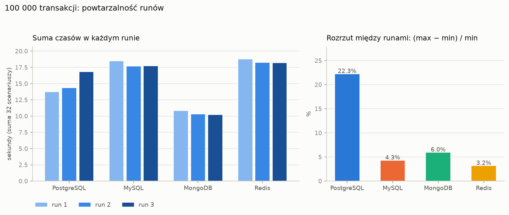
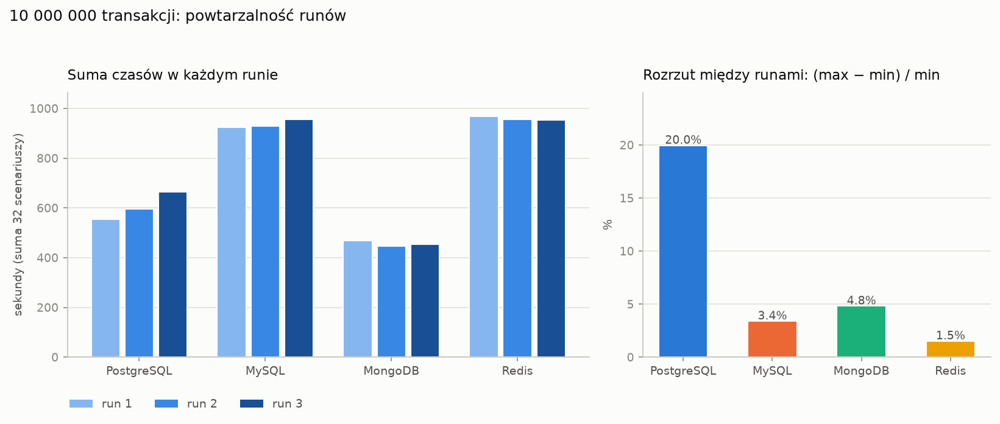
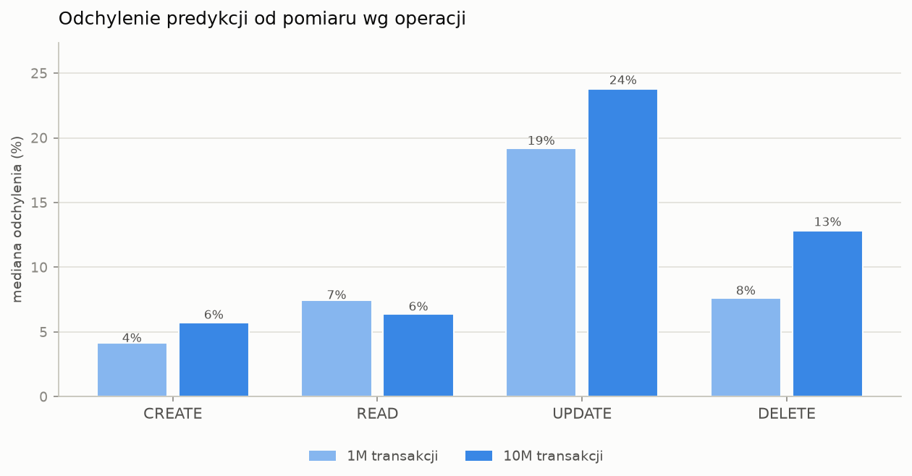
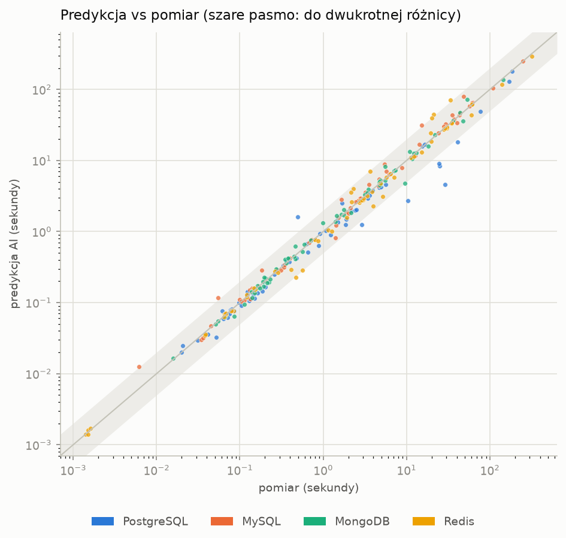

# Wyniki benchmarku

Źródło: `runs.csv`. Czasy w sekundach. R1–R3 to kolejne runy, `best*` to najlepszy run (kompletny run z najmniejszą sumą czasów wszystkich 32 scenariuszy; jeśli żaden run nie był kompletny, run z największą liczbą udanych scenariuszy). Tekst zamiast liczby oznacza, że scenariusz się nie udał: `timeout`, `oom`, `error` albo `skipped` (pominięty, bo wcześniejsza modyfikacja danych się nie udała); `DNF` w wierszu SUMA oznacza, że run nie został ukończony. Na wykresach krzyżyk (×) przy osi oznacza scenariusz, który się nie udał, z jego statusem. Skala wykresów jest logarytmiczna. Opis scenariuszy: [SCENARIOS.md](../../SCENARIOS.md).

## Tabele per baza

### PostgreSQL

| Operacja | 100k R1 | 100k R2 | 100k R3 | 100k best* | 1M R1 | 1M R2 | 1M R3 | 1M best* | 10M R1 | 10M R2 | 10M R3 | 10M best* |
|---|---:|---:|---:|---:|---:|---:|---:|---:|---:|---:|---:|---:|
| CREATE (6) | 6.84 | 7.05 | 8.16 | **6.84** | 20.7 | 20.8 | 20.6 | **20.6** | 184.6 | 194.0 | 204.8 | **184.6** |
| READ (14) | 0.51 | 0.55 | 0.59 | **0.51** | 1.61 | 1.63 | 1.63 | **1.63** | 17.8 | 18.5 | 19.0 | **17.8** |
| UPDATE (6) | 4.70 | 5.10 | 5.78 | **4.70** | 20.7 | 20.9 | 20.9 | **20.9** | 215.2 | 244.4 | 251.4 | **215.2** |
| DELETE (6) | 1.72 | 1.68 | 2.29 | **1.72** | 8.53 | 8.55 | 8.46 | **8.46** | 136.4 | 139.0 | 189.4 | **136.4** |
| **SUMA (32)** | 13.8 | 14.4 | 16.8 | **13.8** | 51.5 | 51.9 | 51.5 | **51.5** | 554.0 | 595.9 | 664.6 | **554.0** |

### MySQL

| Operacja | 100k R1 | 100k R2 | 100k R3 | 100k best* | 1M R1 | 1M R2 | 1M R3 | 1M best* | 10M R1 | 10M R2 | 10M R3 | 10M best* |
|---|---:|---:|---:|---:|---:|---:|---:|---:|---:|---:|---:|---:|
| CREATE (6) | 8.38 | 8.00 | 8.24 | **8.00** | 34.1 | 33.5 | 34.0 | **34.0** | 303.6 | 315.3 | 337.1 | **303.6** |
| READ (14) | 3.16 | 3.05 | 2.88 | **3.05** | 22.8 | 25.7 | 22.0 | **22.0** | 283.7 | 284.9 | 283.7 | **283.7** |
| UPDATE (6) | 2.57 | 2.40 | 2.39 | **2.40** | 11.1 | 11.3 | 11.1 | **11.1** | 103.0 | 103.8 | 102.1 | **103.0** |
| DELETE (6) | 4.38 | 4.26 | 4.25 | **4.26** | 21.4 | 21.6 | 21.4 | **21.4** | 233.6 | 224.3 | 232.6 | **233.6** |
| **SUMA (32)** | 18.5 | 17.7 | 17.8 | **17.7** | 89.4 | 92.1 | 88.5 | **88.5** | 923.9 | 928.3 | 955.4 | **923.9** |

### MongoDB

| Operacja | 100k R1 | 100k R2 | 100k R3 | 100k best* | 1M R1 | 1M R2 | 1M R3 | 1M best* | 10M R1 | 10M R2 | 10M R3 | 10M best* |
|---|---:|---:|---:|---:|---:|---:|---:|---:|---:|---:|---:|---:|
| CREATE (6) | 4.15 | 3.92 | 3.93 | **3.93** | 16.2 | 16.1 | 16.1 | **16.1** | 159.0 | 151.8 | 153.3 | **151.8** |
| READ (14) | 1.02 | 0.92 | 0.93 | **0.93** | 3.95 | 3.96 | 3.89 | **3.89** | 43.9 | 39.4 | 39.5 | **39.4** |
| UPDATE (6) | 3.16 | 3.14 | 3.09 | **3.09** | 16.6 | 16.6 | 16.5 | **16.5** | 131.3 | 124.8 | 127.2 | **124.8** |
| DELETE (6) | 2.50 | 2.35 | 2.27 | **2.27** | 12.0 | 11.9 | 12.0 | **12.0** | 134.7 | 131.3 | 132.6 | **131.3** |
| **SUMA (32)** | 10.8 | 10.3 | 10.2 | **10.2** | 48.7 | 48.6 | 48.4 | **48.4** | 469.0 | 447.4 | 452.6 | **447.4** |

### Redis

| Operacja | 100k R1 | 100k R2 | 100k R3 | 100k best* | 1M R1 | 1M R2 | 1M R3 | 1M best* | 10M R1 | 10M R2 | 10M R3 | 10M best* |
|---|---:|---:|---:|---:|---:|---:|---:|---:|---:|---:|---:|---:|
| CREATE (6) | 8.05 | 7.81 | 7.75 | **7.75** | 41.2 | 40.8 | 41.1 | **40.8** | 392.8 | 384.4 | 384.0 | **384.0** |
| READ (14) | 3.23 | 3.16 | 3.09 | **3.09** | 26.9 | 26.1 | 26.2 | **26.1** | 261.0 | 260.0 | 261.3 | **261.3** |
| UPDATE (6) | 1.77 | 1.70 | 1.70 | **1.70** | 8.93 | 8.77 | 8.77 | **8.77** | 80.5 | 79.4 | 80.4 | **80.4** |
| DELETE (6) | 5.74 | 5.61 | 5.65 | **5.65** | 25.5 | 25.4 | 25.5 | **25.4** | 233.6 | 231.0 | 227.6 | **227.6** |
| **SUMA (32)** | 18.8 | 18.3 | 18.2 | **18.2** | 102.6 | 101.1 | 101.6 | **101.1** | 967.8 | 954.8 | 953.2 | **953.2** |

## Porównanie baz (najlepsze runy)

### 100 000 transakcji

| Operacja | PostgreSQL | MySQL | MongoDB | Redis |
|---|---:|---:|---:|---:|
| CREATE (6) | 6.84 | 8.00 | **3.93** | 7.75 |
| READ (14) | **0.51** | 3.05 | 0.93 | 3.09 |
| UPDATE (6) | 4.70 | 2.40 | 3.09 | **1.70** |
| DELETE (6) | **1.72** | 4.26 | 2.27 | 5.65 |
| **SUMA (32)** | 13.8 | 17.7 | **10.2** | 18.2 |
| najlepszy run | run 1 | run 2 | run 3 | run 3 |

Wszystkie 32 scenariusze

| # | Scenariusz | Op. | Trudność | PostgreSQL | MySQL | MongoDB | Redis |
|---|---:|---:|---:|---:|---:|---:|---:|
| 1 | Masowe ładowanie danych | CREATE | heavy | 1.97 | 2.91 | **1.56** | 2.96 |
| 2 | Odczyt po kluczu głównym (×1000) | READ | easy | **0.07** | 0.13 | 0.14 | 0.07 |
| 3 | Przychód per region (kanał Online) | READ | easy | 0.03 | **0.03** | 0.04 | 0.11 |
| 4 | Liczba transakcji z jednego miesiąca | READ | easy | 0.00 | **0.00** | 0.01 | 0.00 |
| 5 | Przychód per kategoria (JOIN 2 tabel) | READ | medium | **0.03** | 0.23 | 0.06 | 0.32 |
| 6 | Top 10 produktów wg przychodu | READ | medium | **0.03** | 0.25 | 0.05 | 0.27 |
| 7 | Zakupy 200 klientów z nazwami produktów | READ | medium | **0.02** | 0.03 | 0.05 | 0.03 |
| 8 | Segment × kategoria × region (JOIN 3 tabel) | READ | heavy | **0.03** | 0.20 | 0.05 | 0.21 |
| 9 | Miesięczny przychód per kategoria i grupa wiekowa | READ | heavy | 0.08 | 0.48 | **0.07** | 0.49 |
| 10 | Pojedyncze INSERT-y (×1000) | CREATE | easy | **0.10** | 0.13 | 0.15 | 0.11 |
| 11 | Wstawienie paczki 10 000 transakcji | CREATE | medium | 0.37 | 0.28 | **0.16** | 0.24 |
| 12 | Masowe wstawienie 100 000 transakcji | CREATE | heavy | 3.33 | 2.68 | **1.57** | 2.54 |
| 13 | Nowi klienci wraz z transakcjami (jedna transakcja) | CREATE | heavy | 0.90 | 0.64 | **0.31** | 0.75 |
| 14 | Odczyt wstawionych rekordów po kluczu (×1000) | READ | easy | **0.06** | 0.14 | 0.15 | 0.07 |
| 15 | Tabela zagregowana (CREATE TABLE AS, JOIN 3 tabel) | CREATE | heavy | **0.17** | 1.36 | 0.18 | 1.15 |
| 16 | Update po kluczu (×1000) | UPDATE | easy | **0.08** | 0.10 | 0.15 | 0.08 |
| 17 | Update po filtrze (region + miesiąc) | UPDATE | medium | 0.04 | 0.04 | **0.03** | 0.08 |
| 18 | Masowy update co setnej transakcji | UPDATE | heavy | 0.03 | 0.02 | 0.02 | **0.01** |
| 19 | Update całej tabeli z warunkiem (2 pola, pełny skan) | UPDATE | heavy | 3.71 | 1.16 | 1.15 | **0.71** |
| 20 | Update przez JOIN (wszystkie transakcje jednej kategorii) | UPDATE | heavy | 0.48 | 0.32 | **0.22** | 0.42 |
| 21 | Awans największych klientów (update z agregacją) | UPDATE | heavy | **0.36** | 0.76 | 1.51 | 0.41 |
| 22 | Przychód per kategoria po update'ach | READ | medium | **0.04** | 0.71 | 0.12 | 0.74 |
| 23 | Segment × kategoria × region po update'ach | READ | heavy | **0.05** | 0.49 | 0.11 | 0.51 |
| 24 | Usunięcie po kluczu (×1000) | DELETE | easy | **0.06** | 0.11 | 0.16 | 0.15 |
| 25 | Usunięcie po filtrze (region + miesiąc) | DELETE | medium | **0.02** | 0.08 | 0.04 | 0.09 |
| 26 | Usunięcie ok. 50% najstarszych transakcji | DELETE | heavy | **0.06** | 1.18 | 0.72 | 2.86 |
| 27 | Usunięcie transakcji klientów `Top spender` (podzapytanie) | DELETE | heavy | **0.27** | 1.77 | 0.43 | 2.16 |
| 28 | Usunięcie klientów bez transakcji (anty-join) | DELETE | heavy | 0.45 | **0.19** | 0.70 | 0.36 |
| 29 | Liczba transakcji po usunięciach | READ | easy | 0.01 | 0.01 | 0.02 | **0.00** |
| 30 | Przychód per kategoria po usunięciach | READ | medium | **0.02** | 0.12 | 0.03 | 0.12 |
| 31 | Segment × kategoria × region po usunięciach | READ | heavy | **0.03** | 0.23 | 0.04 | 0.15 |
| 32 | Usunięcie wszystkich danych | DELETE | heavy | 0.86 | 0.94 | 0.23 | **0.03** |

### 1 000 000 transakcji

| Operacja | PostgreSQL | MySQL | MongoDB | Redis |
|---|---:|---:|---:|---:|
| CREATE (6) | 20.6 | 34.0 | **16.1** | 40.8 |
| READ (14) | **1.63** | 22.0 | 3.89 | 26.1 |
| UPDATE (6) | 20.9 | 11.1 | 16.5 | **8.77** |
| DELETE (6) | **8.46** | 21.4 | 12.0 | 25.4 |
| **SUMA (32)** | 51.5 | 88.5 | **48.4** | 101.1 |
| najlepszy run | run 3 | run 3 | run 3 | run 2 |

Wszystkie 32 scenariusze

| # | Scenariusz | Op. | Trudność | PostgreSQL | MySQL | MongoDB | Redis |
|---|---:|---:|---:|---:|---:|---:|---:|
| 1 | Masowe ładowanie danych | CREATE | heavy | 15.4 | 24.4 | **13.0** | 30.5 |
| 2 | Odczyt po kluczu głównym (×1000) | READ | easy | 0.09 | 0.14 | 0.16 | **0.07** |
| 3 | Przychód per region (kanał Online) | READ | easy | **0.06** | 0.28 | 0.27 | 1.14 |
| 4 | Liczba transakcji z jednego miesiąca | READ | easy | 0.02 | 0.01 | 0.02 | **0.00** |
| 5 | Przychód per kategoria (JOIN 2 tabel) | READ | medium | **0.12** | 2.72 | 0.46 | 3.38 |
| 6 | Top 10 produktów wg przychodu | READ | medium | **0.12** | 2.83 | 0.35 | 2.98 |
| 7 | Zakupy 200 klientów z nazwami produktów | READ | medium | **0.02** | 0.03 | 0.05 | 0.04 |
| 8 | Segment × kategoria × region (JOIN 3 tabel) | READ | heavy | **0.16** | 2.08 | 0.38 | 2.70 |
| 9 | Miesięczny przychód per kategoria i grupa wiekowa | READ | heavy | **0.33** | 4.66 | 0.59 | 5.70 |
| 10 | Pojedyncze INSERT-y (×1000) | CREATE | easy | **0.10** | 0.17 | 0.16 | 0.12 |
| 11 | Wstawienie paczki 10 000 transakcji | CREATE | medium | 0.36 | 0.29 | **0.18** | 0.26 |
| 12 | Masowe wstawienie 100 000 transakcji | CREATE | heavy | 3.40 | 2.69 | **1.67** | 2.74 |
| 13 | Nowi klienci wraz z transakcjami (jedna transakcja) | CREATE | heavy | 0.89 | 0.68 | **0.35** | 0.80 |
| 14 | Odczyt wstawionych rekordów po kluczu (×1000) | READ | easy | 0.08 | 0.14 | 0.14 | **0.07** |
| 15 | Tabela zagregowana (CREATE TABLE AS, JOIN 3 tabel) | CREATE | heavy | **0.39** | 5.75 | 0.71 | 6.41 |
| 16 | Update po kluczu (×1000) | UPDATE | easy | 0.11 | 0.16 | 0.14 | **0.08** |
| 17 | Update po filtrze (region + miesiąc) | UPDATE | medium | 0.15 | 0.21 | **0.13** | 0.47 |
| 18 | Masowy update co setnej transakcji | UPDATE | heavy | 0.18 | 0.15 | 0.10 | **0.08** |
| 19 | Update całej tabeli z warunkiem (2 pola, pełny skan) | UPDATE | heavy | 16.5 | 5.41 | 5.48 | **3.65** |
| 20 | Update przez JOIN (wszystkie transakcje jednej kategorii) | UPDATE | heavy | 2.86 | 1.64 | **1.02** | 2.31 |
| 21 | Awans największych klientów (update z agregacją) | UPDATE | heavy | **1.03** | 3.52 | 9.60 | 2.17 |
| 22 | Przychód per kategoria po update'ach | READ | medium | **0.16** | 3.21 | 0.54 | 3.83 |
| 23 | Segment × kategoria × region po update'ach | READ | heavy | **0.20** | 2.44 | 0.50 | 3.05 |
| 24 | Usunięcie po kluczu (×1000) | DELETE | easy | **0.06** | 0.10 | 0.16 | 0.15 |
| 25 | Usunięcie po filtrze (region + miesiąc) | DELETE | medium | **0.05** | 0.34 | 0.15 | 0.56 |
| 26 | Usunięcie ok. 50% najstarszych transakcji | DELETE | heavy | **0.26** | 6.24 | 3.40 | 15.1 |
| 27 | Usunięcie transakcji klientów `Top spender` (podzapytanie) | DELETE | heavy | **0.66** | 4.60 | 1.32 | 7.04 |
| 28 | Usunięcie klientów bez transakcji (anty-join) | DELETE | heavy | 1.86 | **1.42** | 4.74 | 2.20 |
| 29 | Liczba transakcji po usunięciach | READ | easy | 0.05 | 0.05 | 0.07 | **0.00** |
| 30 | Przychód per kategoria po usunięciach | READ | medium | **0.08** | 1.40 | 0.17 | 1.25 |
| 31 | Segment × kategoria × region po usunięciach | READ | heavy | **0.13** | 2.00 | 0.19 | 1.92 |
| 32 | Usunięcie wszystkich danych | DELETE | heavy | 5.58 | 8.69 | 2.19 | **0.29** |

### 10 000 000 transakcji

| Operacja | PostgreSQL | MySQL | MongoDB | Redis |
|---|---:|---:|---:|---:|
| CREATE (6) | 184.6 | 303.6 | **151.8** | 384.0 |
| READ (14) | **17.8** | 283.7 | 39.4 | 261.3 |
| UPDATE (6) | 215.2 | 103.0 | 124.8 | **80.4** |
| DELETE (6) | 136.4 | 233.6 | **131.3** | 227.6 |
| **SUMA (32)** | 554.0 | 923.9 | **447.4** | 953.2 |
| najlepszy run | run 1 | run 1 | run 2 | run 3 |

Wszystkie 32 scenariusze

| # | Scenariusz | Op. | Trudność | PostgreSQL | MySQL | MongoDB | Redis |
|---|---:|---:|---:|---:|---:|---:|---:|
| 1 | Masowe ładowanie danych | CREATE | heavy | 174.8 | 238.1 | **141.9** | 318.4 |
| 2 | Odczyt po kluczu głównym (×1000) | READ | easy | 0.11 | 0.15 | 0.24 | **0.06** |
| 3 | Przychód per region (kanał Online) | READ | easy | **0.58** | 2.85 | 3.49 | 11.3 |
| 4 | Liczba transakcji z jednego miesiąca | READ | easy | 0.34 | 0.06 | 0.05 | **0.00** |
| 5 | Przychód per kategoria (JOIN 2 tabel) | READ | medium | **1.33** | 28.1 | 4.83 | 34.5 |
| 6 | Top 10 produktów wg przychodu | READ | medium | **1.37** | 36.9 | 4.51 | 30.5 |
| 7 | Zakupy 200 klientów z nazwami produktów | READ | medium | **0.04** | 0.04 | 0.07 | 0.04 |
| 8 | Segment × kategoria × region (JOIN 3 tabel) | READ | heavy | **2.00** | 42.6 | 4.69 | 28.4 |
| 9 | Miesięczny przychód per kategoria i grupa wiekowa | READ | heavy | **4.23** | 57.2 | 7.07 | 60.5 |
| 10 | Pojedyncze INSERT-y (×1000) | CREATE | easy | 0.14 | 0.17 | 0.20 | **0.12** |
| 11 | Wstawienie paczki 10 000 transakcji | CREATE | medium | 0.43 | 0.34 | **0.22** | 0.41 |
| 12 | Masowe wstawienie 100 000 transakcji | CREATE | heavy | 3.88 | 2.80 | **1.78** | 2.87 |
| 13 | Nowi klienci wraz z transakcjami (jedna transakcja) | CREATE | heavy | 1.02 | 0.72 | **0.37** | 0.80 |
| 14 | Odczyt wstawionych rekordów po kluczu (×1000) | READ | easy | 0.08 | 0.14 | 0.14 | **0.06** |
| 15 | Tabela zagregowana (CREATE TABLE AS, JOIN 3 tabel) | CREATE | heavy | **4.27** | 61.5 | 7.36 | 61.4 |
| 16 | Update po kluczu (×1000) | UPDATE | easy | 0.14 | 0.11 | 0.23 | **0.08** |
| 17 | Update po filtrze (region + miesiąc) | UPDATE | medium | 3.09 | **1.93** | 11.6 | 4.00 |
| 18 | Masowy update co setnej transakcji | UPDATE | heavy | 3.40 | 1.60 | 3.32 | **0.86** |
| 19 | Update całej tabeli z warunkiem (2 pola, pełny skan) | UPDATE | heavy | 163.8 | 48.5 | 51.9 | **33.4** |
| 20 | Update przez JOIN (wszystkie transakcje jednej kategorii) | UPDATE | heavy | 25.9 | 15.4 | **10.8** | 21.1 |
| 21 | Awans największych klientów (update z agregacją) | UPDATE | heavy | **19.0** | 35.5 | 47.0 | 21.0 |
| 22 | Przychód per kategoria po update'ach | READ | medium | **1.69** | 29.5 | 5.69 | 35.0 |
| 23 | Segment × kategoria × region po update'ach | READ | heavy | **2.70** | 43.7 | 4.93 | 28.9 |
| 24 | Usunięcie po kluczu (×1000) | DELETE | easy | **0.09** | 0.56 | 0.19 | 0.15 |
| 25 | Usunięcie po filtrze (region + miesiąc) | DELETE | medium | **1.59** | 3.30 | 18.2 | 5.22 |
| 26 | Usunięcie ok. 50% najstarszych transakcji | DELETE | heavy | **4.22** | 61.6 | 36.0 | 139.6 |
| 27 | Usunięcie transakcji klientów `Top spender` (podzapytanie) | DELETE | heavy | 29.0 | 46.1 | **11.6** | 58.9 |
| 28 | Usunięcie klientów bez transakcji (anty-join) | DELETE | heavy | 24.6 | **12.7** | 43.4 | 19.4 |
| 29 | Liczba transakcji po usunięciach | READ | easy | 0.53 | 0.40 | 0.47 | **0.00** |
| 30 | Przychód per kategoria po usunięciach | READ | medium | **0.92** | 14.1 | 1.43 | 12.2 |
| 31 | Segment × kategoria × region po usunięciach | READ | heavy | 1.91 | 28.0 | **1.78** | 19.7 |
| 32 | Usunięcie wszystkich danych | DELETE | heavy | 76.9 | 109.3 | 21.8 | **4.30** |

## Powtarzalność runów

Suma czasów wszystkich 32 scenariuszy w każdym runie (sekundy) i rozrzut między kompletnymi runami: (największy − najmniejszy) / najmniejszy. Mały rozrzut znaczy, że różnice między bazami są większe niż szum pomiaru.

### 100 000 transakcji

| Baza | run 1 | run 2 | run 3 | rozrzut |
|---|---:|---:|---:|---:|
| PostgreSQL | 13.8 | 14.4 | 16.8 | 22% |
| MySQL | 18.5 | 17.7 | 17.8 | 4% |
| MongoDB | 10.8 | 10.3 | 10.2 | 6% |
| Redis | 18.8 | 18.3 | 18.2 | 3% |

### 1 000 000 transakcji

| Baza | run 1 | run 2 | run 3 | rozrzut |
|---|---:|---:|---:|---:|
| PostgreSQL | 51.5 | 51.9 | 51.5 | 1% |
| MySQL | 89.4 | 92.1 | 88.5 | 4% |
| MongoDB | 48.7 | 48.6 | 48.4 | 1% |
| Redis | 102.6 | 101.1 | 101.6 | 1% |

### 10 000 000 transakcji

| Baza | run 1 | run 2 | run 3 | rozrzut |
|---|---:|---:|---:|---:|
| PostgreSQL | 554.0 | 595.9 | 664.6 | 20% |
| MySQL | 923.9 | 928.3 | 955.4 | 3% |
| MongoDB | 469.0 | 447.4 | 452.6 | 5% |
| Redis | 967.8 | 954.8 | 953.2 | 2% |

## Załącznik: wszystkie scenariusze w każdym runie

PostgreSQL

| # | Scenariusz | 100k R1 | 100k R2 | 100k R3 | 1M R1 | 1M R2 | 1M R3 | 10M R1 | 10M R2 | 10M R3 |
|---|---:|---:|---:|---:|---:|---:|---:|---:|---:|---:|
| 1 | Masowe ładowanie danych | 1.97 | 2.09 | 2.03 | 15.5 | 15.5 | 15.4 | 174.8 | 183.4 | 193.0 |
| 2 | Odczyt po kluczu głównym (×1000) | 0.07 | 0.08 | 0.07 | 0.09 | 0.08 | 0.09 | 0.11 | 0.18 | 0.13 |
| 3 | Przychód per region (kanał Online) | 0.03 | 0.01 | 0.01 | 0.06 | 0.06 | 0.06 | 0.58 | 0.63 | 0.68 |
| 4 | Liczba transakcji z jednego miesiąca | 0.00 | 0.01 | 0.00 | 0.02 | 0.02 | 0.02 | 0.34 | 0.36 | 0.37 |
| 5 | Przychód per kategoria (JOIN 2 tabel) | 0.03 | 0.05 | 0.03 | 0.12 | 0.12 | 0.12 | 1.33 | 1.46 | 1.71 |
| 6 | Top 10 produktów wg przychodu | 0.03 | 0.03 | 0.03 | 0.12 | 0.13 | 0.12 | 1.37 | 1.49 | 1.60 |
| 7 | Zakupy 200 klientów z nazwami produktów | 0.02 | 0.02 | 0.02 | 0.02 | 0.02 | 0.02 | 0.04 | 0.03 | 0.03 |
| 8 | Segment × kategoria × region (JOIN 3 tabel) | 0.03 | 0.03 | 0.04 | 0.17 | 0.16 | 0.16 | 2.00 | 2.47 | 2.16 |
| 9 | Miesięczny przychód per kategoria i grupa wiekowa | 0.08 | 0.08 | 0.08 | 0.33 | 0.36 | 0.33 | 4.23 | 4.69 | 4.69 |
| 10 | Pojedyncze INSERT-y (×1000) | 0.10 | 0.10 | 0.10 | 0.10 | 0.10 | 0.10 | 0.14 | 0.14 | 0.18 |
| 11 | Wstawienie paczki 10 000 transakcji | 0.37 | 0.39 | 0.40 | 0.36 | 0.36 | 0.36 | 0.43 | 0.50 | 0.48 |
| 12 | Masowe wstawienie 100 000 transakcji | 3.33 | 3.35 | 4.35 | 3.46 | 3.52 | 3.40 | 3.88 | 3.93 | 4.66 |
| 13 | Nowi klienci wraz z transakcjami (jedna transakcja) | 0.90 | 0.95 | 1.07 | 0.90 | 0.92 | 0.89 | 1.02 | 1.08 | 1.23 |
| 14 | Odczyt wstawionych rekordów po kluczu (×1000) | 0.06 | 0.08 | 0.10 | 0.07 | 0.07 | 0.08 | 0.08 | 0.07 | 0.08 |
| 15 | Tabela zagregowana (CREATE TABLE AS, JOIN 3 tabel) | 0.17 | 0.17 | 0.21 | 0.39 | 0.42 | 0.39 | 4.27 | 4.95 | 5.22 |
| 16 | Update po kluczu (×1000) | 0.08 | 0.08 | 0.11 | 0.10 | 0.09 | 0.11 | 0.14 | 0.18 | 0.15 |
| 17 | Update po filtrze (region + miesiąc) | 0.04 | 0.04 | 0.05 | 0.16 | 0.15 | 0.15 | 3.09 | 3.41 | 3.47 |
| 18 | Masowy update co setnej transakcji | 0.03 | 0.03 | 0.04 | 0.18 | 0.19 | 0.18 | 3.40 | 3.61 | 3.96 |
| 19 | Update całej tabeli z warunkiem (2 pola, pełny skan) | 3.71 | 4.08 | 4.60 | 16.8 | 16.5 | 16.5 | 163.8 | 171.5 | 176.7 |
| 20 | Update przez JOIN (wszystkie transakcje jednej kategorii) | 0.48 | 0.52 | 0.59 | 2.25 | 2.42 | 2.86 | 25.9 | 40.7 | 41.0 |
| 21 | Awans największych klientów (update z agregacją) | 0.36 | 0.36 | 0.40 | 1.24 | 1.52 | 1.03 | 19.0 | 24.9 | 26.1 |
| 22 | Przychód per kategoria po update'ach | 0.04 | 0.04 | 0.06 | 0.16 | 0.17 | 0.16 | 1.69 | 1.63 | 1.76 |
| 23 | Segment × kategoria × region po update'ach | 0.05 | 0.05 | 0.06 | 0.20 | 0.20 | 0.20 | 2.70 | 2.35 | 2.49 |
| 24 | Usunięcie po kluczu (×1000) | 0.06 | 0.06 | 0.09 | 0.06 | 0.07 | 0.06 | 0.09 | 0.07 | 0.08 |
| 25 | Usunięcie po filtrze (region + miesiąc) | 0.02 | 0.01 | 0.02 | 0.05 | 0.05 | 0.05 | 1.59 | 3.64 | 2.90 |
| 26 | Usunięcie ok. 50% najstarszych transakcji | 0.06 | 0.06 | 0.07 | 0.26 | 0.28 | 0.26 | 4.22 | 10.8 | 10.3 |
| 27 | Usunięcie transakcji klientów `Top spender` (podzapytanie) | 0.27 | 0.24 | 0.29 | 0.66 | 0.65 | 0.66 | 29.0 | 23.1 | 67.9 |
| 28 | Usunięcie klientów bez transakcji (anty-join) | 0.45 | 0.44 | 0.56 | 1.85 | 1.89 | 1.86 | 24.6 | 24.3 | 24.9 |
| 29 | Liczba transakcji po usunięciach | 0.01 | 0.01 | 0.01 | 0.04 | 0.04 | 0.05 | 0.53 | 0.42 | 0.49 |
| 30 | Przychód per kategoria po usunięciach | 0.02 | 0.02 | 0.03 | 0.07 | 0.07 | 0.08 | 0.92 | 0.87 | 0.89 |
| 31 | Segment × kategoria × region po usunięciach | 0.03 | 0.03 | 0.04 | 0.13 | 0.13 | 0.13 | 1.91 | 1.86 | 1.90 |
| 32 | Usunięcie wszystkich danych | 0.86 | 0.86 | 1.27 | 5.64 | 5.61 | 5.58 | 76.9 | 77.1 | 83.3 |

MySQL

| # | Scenariusz | 100k R1 | 100k R2 | 100k R3 | 1M R1 | 1M R2 | 1M R3 | 10M R1 | 10M R2 | 10M R3 |
|---|---:|---:|---:|---:|---:|---:|---:|---:|---:|---:|
| 1 | Masowe ładowanie danych | 3.10 | 2.91 | 3.30 | 24.1 | 24.0 | 24.4 | 238.1 | 249.3 | 271.2 |
| 2 | Odczyt po kluczu głównym (×1000) | 0.17 | 0.13 | 0.14 | 0.15 | 0.14 | 0.14 | 0.15 | 0.13 | 0.13 |
| 3 | Przychód per region (kanał Online) | 0.03 | 0.03 | 0.03 | 0.28 | 0.28 | 0.28 | 2.85 | 2.78 | 2.77 |
| 4 | Liczba transakcji z jednego miesiąca | 0.01 | 0.00 | 0.00 | 0.01 | 0.01 | 0.01 | 0.06 | 0.05 | 0.05 |
| 5 | Przychód per kategoria (JOIN 2 tabel) | 0.24 | 0.23 | 0.21 | 2.72 | 2.73 | 2.72 | 28.1 | 28.2 | 28.4 |
| 6 | Top 10 produktów wg przychodu | 0.23 | 0.25 | 0.23 | 2.85 | 2.83 | 2.83 | 36.9 | 37.0 | 37.0 |
| 7 | Zakupy 200 klientów z nazwami produktów | 0.03 | 0.03 | 0.03 | 0.04 | 0.03 | 0.03 | 0.04 | 0.03 | 0.04 |
| 8 | Segment × kategoria × region (JOIN 3 tabel) | 0.21 | 0.20 | 0.20 | 2.11 | 3.80 | 2.08 | 42.6 | 42.9 | 42.9 |
| 9 | Miesięczny przychód per kategoria i grupa wiekowa | 0.47 | 0.48 | 0.45 | 5.40 | 4.65 | 4.66 | 57.2 | 57.2 | 57.2 |
| 10 | Pojedyncze INSERT-y (×1000) | 0.13 | 0.13 | 0.13 | 0.16 | 0.22 | 0.17 | 0.17 | 0.22 | 0.18 |
| 11 | Wstawienie paczki 10 000 transakcji | 0.28 | 0.28 | 0.27 | 0.35 | 0.31 | 0.29 | 0.34 | 0.33 | 0.35 |
| 12 | Masowe wstawienie 100 000 transakcji | 2.74 | 2.68 | 2.54 | 2.63 | 2.64 | 2.69 | 2.80 | 2.83 | 2.76 |
| 13 | Nowi klienci wraz z transakcjami (jedna transakcja) | 0.74 | 0.64 | 0.69 | 0.68 | 0.66 | 0.68 | 0.72 | 0.73 | 0.68 |
| 14 | Odczyt wstawionych rekordów po kluczu (×1000) | 0.17 | 0.14 | 0.15 | 0.14 | 0.14 | 0.14 | 0.14 | 0.15 | 0.15 |
| 15 | Tabela zagregowana (CREATE TABLE AS, JOIN 3 tabel) | 1.39 | 1.36 | 1.31 | 6.18 | 5.71 | 5.75 | 61.5 | 61.9 | 61.9 |
| 16 | Update po kluczu (×1000) | 0.13 | 0.10 | 0.10 | 0.11 | 0.11 | 0.16 | 0.11 | 0.10 | 0.10 |
| 17 | Update po filtrze (region + miesiąc) | 0.05 | 0.04 | 0.04 | 0.20 | 0.22 | 0.21 | 1.93 | 1.88 | 1.80 |
| 18 | Masowy update co setnej transakcji | 0.02 | 0.02 | 0.02 | 0.15 | 0.19 | 0.15 | 1.60 | 1.52 | 1.50 |
| 19 | Update całej tabeli z warunkiem (2 pola, pełny skan) | 1.22 | 1.16 | 1.17 | 5.46 | 5.50 | 5.41 | 48.5 | 50.2 | 48.0 |
| 20 | Update przez JOIN (wszystkie transakcje jednej kategorii) | 0.34 | 0.32 | 0.31 | 1.65 | 1.75 | 1.64 | 15.4 | 14.8 | 15.1 |
| 21 | Awans największych klientów (update z agregacją) | 0.81 | 0.76 | 0.74 | 3.50 | 3.53 | 3.52 | 35.5 | 35.3 | 35.5 |
| 22 | Przychód per kategoria po update'ach | 0.68 | 0.71 | 0.62 | 3.23 | 3.22 | 3.21 | 29.5 | 29.4 | 29.3 |
| 23 | Segment × kategoria × region po update'ach | 0.58 | 0.49 | 0.47 | 2.45 | 4.41 | 2.44 | 43.7 | 44.4 | 44.1 |
| 24 | Usunięcie po kluczu (×1000) | 0.10 | 0.11 | 0.12 | 0.11 | 0.10 | 0.10 | 0.56 | 0.13 | 0.09 |
| 25 | Usunięcie po filtrze (region + miesiąc) | 0.07 | 0.08 | 0.07 | 0.33 | 0.37 | 0.34 | 3.30 | 3.30 | 3.33 |
| 26 | Usunięcie ok. 50% najstarszych transakcji | 1.28 | 1.18 | 1.19 | 6.15 | 6.18 | 6.24 | 61.6 | 61.2 | 61.2 |
| 27 | Usunięcie transakcji klientów `Top spender` (podzapytanie) | 1.80 | 1.77 | 1.77 | 4.63 | 4.75 | 4.60 | 46.1 | 40.4 | 40.4 |
| 28 | Usunięcie klientów bez transakcji (anty-join) | 0.19 | 0.19 | 0.18 | 1.42 | 1.43 | 1.42 | 12.7 | 12.7 | 12.9 |
| 29 | Liczba transakcji po usunięciach | 0.01 | 0.01 | 0.01 | 0.04 | 0.04 | 0.05 | 0.40 | 0.40 | 0.37 |
| 30 | Przychód per kategoria po usunięciach | 0.12 | 0.12 | 0.12 | 1.41 | 1.40 | 1.40 | 14.1 | 14.2 | 13.8 |
| 31 | Segment × kategoria × region po usunięciach | 0.22 | 0.23 | 0.22 | 2.02 | 2.03 | 2.00 | 28.0 | 27.9 | 27.5 |
| 32 | Usunięcie wszystkich danych | 0.93 | 0.94 | 0.92 | 8.75 | 8.76 | 8.69 | 109.3 | 106.5 | 114.7 |

MongoDB

| # | Scenariusz | 100k R1 | 100k R2 | 100k R3 | 1M R1 | 1M R2 | 1M R3 | 10M R1 | 10M R2 | 10M R3 |
|---|---:|---:|---:|---:|---:|---:|---:|---:|---:|---:|
| 1 | Masowe ładowanie danych | 1.61 | 1.49 | 1.56 | 13.1 | 13.0 | 13.0 | 149.0 | 141.9 | 143.4 |
| 2 | Odczyt po kluczu głównym (×1000) | 0.16 | 0.17 | 0.14 | 0.15 | 0.15 | 0.16 | 0.20 | 0.24 | 0.19 |
| 3 | Przychód per region (kanał Online) | 0.05 | 0.04 | 0.04 | 0.27 | 0.27 | 0.27 | 4.18 | 3.49 | 3.38 |
| 4 | Liczba transakcji z jednego miesiąca | 0.01 | 0.01 | 0.01 | 0.02 | 0.02 | 0.02 | 0.06 | 0.05 | 0.05 |
| 5 | Przychód per kategoria (JOIN 2 tabel) | 0.06 | 0.05 | 0.06 | 0.46 | 0.45 | 0.46 | 6.03 | 4.83 | 4.87 |
| 6 | Top 10 produktów wg przychodu | 0.05 | 0.05 | 0.05 | 0.40 | 0.36 | 0.35 | 6.32 | 4.51 | 4.74 |
| 7 | Zakupy 200 klientów z nazwami produktów | 0.05 | 0.05 | 0.05 | 0.05 | 0.05 | 0.05 | 0.12 | 0.07 | 0.09 |
| 8 | Segment × kategoria × region (JOIN 3 tabel) | 0.06 | 0.05 | 0.05 | 0.38 | 0.42 | 0.38 | 5.74 | 4.69 | 4.61 |
| 9 | Miesięczny przychód per kategoria i grupa wiekowa | 0.08 | 0.07 | 0.07 | 0.60 | 0.58 | 0.59 | 6.93 | 7.07 | 7.36 |
| 10 | Pojedyncze INSERT-y (×1000) | 0.18 | 0.17 | 0.15 | 0.16 | 0.19 | 0.16 | 0.23 | 0.20 | 0.18 |
| 11 | Wstawienie paczki 10 000 transakcji | 0.20 | 0.18 | 0.16 | 0.19 | 0.19 | 0.18 | 0.24 | 0.22 | 0.22 |
| 12 | Masowe wstawienie 100 000 transakcji | 1.62 | 1.60 | 1.57 | 1.65 | 1.70 | 1.67 | 1.74 | 1.78 | 1.76 |
| 13 | Nowi klienci wraz z transakcjami (jedna transakcja) | 0.36 | 0.31 | 0.31 | 0.39 | 0.34 | 0.35 | 0.38 | 0.37 | 0.49 |
| 14 | Odczyt wstawionych rekordów po kluczu (×1000) | 0.16 | 0.13 | 0.15 | 0.14 | 0.14 | 0.14 | 0.14 | 0.14 | 0.14 |
| 15 | Tabela zagregowana (CREATE TABLE AS, JOIN 3 tabel) | 0.19 | 0.17 | 0.18 | 0.70 | 0.73 | 0.71 | 7.37 | 7.36 | 7.29 |
| 16 | Update po kluczu (×1000) | 0.15 | 0.14 | 0.15 | 0.17 | 0.15 | 0.14 | 0.26 | 0.23 | 0.22 |
| 17 | Update po filtrze (region + miesiąc) | 0.03 | 0.03 | 0.03 | 0.15 | 0.14 | 0.13 | 12.0 | 11.6 | 11.5 |
| 18 | Masowy update co setnej transakcji | 0.02 | 0.01 | 0.02 | 0.12 | 0.11 | 0.10 | 3.08 | 3.32 | 3.16 |
| 19 | Update całej tabeli z warunkiem (2 pola, pełny skan) | 1.16 | 1.17 | 1.15 | 5.52 | 5.50 | 5.48 | 54.3 | 51.9 | 53.4 |
| 20 | Update przez JOIN (wszystkie transakcje jednej kategorii) | 0.23 | 0.22 | 0.22 | 0.99 | 0.99 | 1.02 | 11.2 | 10.8 | 10.9 |
| 21 | Awans największych klientów (update z agregacją) | 1.57 | 1.56 | 1.51 | 9.61 | 9.74 | 9.60 | 50.5 | 47.0 | 47.9 |
| 22 | Przychód per kategoria po update'ach | 0.13 | 0.13 | 0.12 | 0.56 | 0.59 | 0.54 | 5.53 | 5.69 | 5.31 |
| 23 | Segment × kategoria × region po update'ach | 0.11 | 0.11 | 0.11 | 0.44 | 0.43 | 0.50 | 4.85 | 4.93 | 5.00 |
| 24 | Usunięcie po kluczu (×1000) | 0.17 | 0.15 | 0.16 | 0.15 | 0.16 | 0.16 | 0.34 | 0.19 | 0.18 |
| 25 | Usunięcie po filtrze (region + miesiąc) | 0.04 | 0.04 | 0.04 | 0.15 | 0.15 | 0.15 | 18.9 | 18.2 | 18.3 |
| 26 | Usunięcie ok. 50% najstarszych transakcji | 0.83 | 0.76 | 0.72 | 3.38 | 3.37 | 3.40 | 37.4 | 36.0 | 35.4 |
| 27 | Usunięcie transakcji klientów `Top spender` (podzapytanie) | 0.47 | 0.46 | 0.43 | 1.44 | 1.39 | 1.32 | 12.2 | 11.6 | 12.2 |
| 28 | Usunięcie klientów bez transakcji (anty-join) | 0.75 | 0.71 | 0.70 | 4.74 | 4.71 | 4.74 | 43.9 | 43.4 | 44.0 |
| 29 | Liczba transakcji po usunięciach | 0.02 | 0.02 | 0.02 | 0.07 | 0.08 | 0.07 | 0.46 | 0.47 | 0.45 |
| 30 | Przychód per kategoria po usunięciach | 0.04 | 0.03 | 0.03 | 0.17 | 0.21 | 0.17 | 1.45 | 1.43 | 1.51 |
| 31 | Segment × kategoria × region po usunięciach | 0.04 | 0.03 | 0.04 | 0.23 | 0.21 | 0.19 | 1.89 | 1.78 | 1.75 |
| 32 | Usunięcie wszystkich danych | 0.24 | 0.23 | 0.23 | 2.14 | 2.09 | 2.19 | 22.0 | 21.8 | 22.6 |

Redis

| # | Scenariusz | 100k R1 | 100k R2 | 100k R3 | 1M R1 | 1M R2 | 1M R3 | 10M R1 | 10M R2 | 10M R3 |
|---|---:|---:|---:|---:|---:|---:|---:|---:|---:|---:|
| 1 | Masowe ładowanie danych | 3.05 | 2.99 | 2.96 | 30.6 | 30.5 | 30.7 | 326.7 | 319.6 | 318.4 |
| 2 | Odczyt po kluczu głównym (×1000) | 0.07 | 0.06 | 0.07 | 0.07 | 0.07 | 0.07 | 0.07 | 0.07 | 0.06 |
| 3 | Przychód per region (kanał Online) | 0.11 | 0.12 | 0.11 | 1.17 | 1.14 | 1.14 | 11.2 | 11.3 | 11.3 |
| 4 | Liczba transakcji z jednego miesiąca | 0.00 | 0.00 | 0.00 | 0.00 | 0.00 | 0.00 | 0.00 | 0.00 | 0.00 |
| 5 | Przychód per kategoria (JOIN 2 tabel) | 0.32 | 0.33 | 0.32 | 3.48 | 3.38 | 3.39 | 34.5 | 34.3 | 34.5 |
| 6 | Top 10 produktów wg przychodu | 0.28 | 0.29 | 0.27 | 3.08 | 2.98 | 2.97 | 30.2 | 30.2 | 30.5 |
| 7 | Zakupy 200 klientów z nazwami produktów | 0.03 | 0.03 | 0.03 | 0.04 | 0.04 | 0.04 | 0.04 | 0.04 | 0.04 |
| 8 | Segment × kategoria × region (JOIN 3 tabel) | 0.22 | 0.22 | 0.21 | 2.77 | 2.70 | 2.70 | 28.2 | 28.0 | 28.4 |
| 9 | Miesięczny przychód per kategoria i grupa wiekowa | 0.54 | 0.49 | 0.49 | 5.92 | 5.70 | 5.71 | 60.9 | 59.9 | 60.5 |
| 10 | Pojedyncze INSERT-y (×1000) | 0.12 | 0.12 | 0.11 | 0.12 | 0.12 | 0.12 | 0.13 | 0.11 | 0.12 |
| 11 | Wstawienie paczki 10 000 transakcji | 0.25 | 0.24 | 0.24 | 0.26 | 0.26 | 0.39 | 0.43 | 0.41 | 0.41 |
| 12 | Masowe wstawienie 100 000 transakcji | 2.64 | 2.56 | 2.54 | 2.74 | 2.74 | 2.75 | 2.92 | 2.88 | 2.87 |
| 13 | Nowi klienci wraz z transakcjami (jedna transakcja) | 0.79 | 0.75 | 0.75 | 0.80 | 0.80 | 0.81 | 0.84 | 0.80 | 0.80 |
| 14 | Odczyt wstawionych rekordów po kluczu (×1000) | 0.07 | 0.06 | 0.07 | 0.07 | 0.07 | 0.07 | 0.06 | 0.06 | 0.06 |
| 15 | Tabela zagregowana (CREATE TABLE AS, JOIN 3 tabel) | 1.20 | 1.14 | 1.15 | 6.66 | 6.41 | 6.39 | 61.7 | 60.6 | 61.4 |
| 16 | Update po kluczu (×1000) | 0.08 | 0.07 | 0.08 | 0.08 | 0.08 | 0.08 | 0.08 | 0.07 | 0.08 |
| 17 | Update po filtrze (region + miesiąc) | 0.07 | 0.08 | 0.08 | 0.47 | 0.47 | 0.48 | 4.07 | 4.01 | 4.00 |
| 18 | Masowy update co setnej transakcji | 0.01 | 0.01 | 0.01 | 0.08 | 0.08 | 0.08 | 0.88 | 0.86 | 0.86 |
| 19 | Update całej tabeli z warunkiem (2 pola, pełny skan) | 0.73 | 0.70 | 0.71 | 3.68 | 3.65 | 3.67 | 34.2 | 33.5 | 33.4 |
| 20 | Update przez JOIN (wszystkie transakcje jednej kategorii) | 0.47 | 0.43 | 0.42 | 2.32 | 2.31 | 2.30 | 21.1 | 21.0 | 21.1 |
| 21 | Awans największych klientów (update z agregacją) | 0.41 | 0.41 | 0.41 | 2.30 | 2.17 | 2.17 | 20.2 | 20.0 | 21.0 |
| 22 | Przychód per kategoria po update'ach | 0.76 | 0.73 | 0.74 | 3.95 | 3.83 | 3.84 | 34.9 | 34.7 | 35.0 |
| 23 | Segment × kategoria × region po update'ach | 0.54 | 0.51 | 0.51 | 3.13 | 3.05 | 3.07 | 28.9 | 28.5 | 28.9 |
| 24 | Usunięcie po kluczu (×1000) | 0.15 | 0.15 | 0.15 | 0.15 | 0.15 | 0.15 | 0.16 | 0.15 | 0.15 |
| 25 | Usunięcie po filtrze (region + miesiąc) | 0.09 | 0.09 | 0.09 | 0.56 | 0.56 | 0.57 | 5.26 | 5.22 | 5.22 |
| 26 | Usunięcie ok. 50% najstarszych transakcji | 2.92 | 2.86 | 2.86 | 15.2 | 15.1 | 15.2 | 143.4 | 139.4 | 139.6 |
| 27 | Usunięcie transakcji klientów `Top spender` (podzapytanie) | 2.17 | 2.11 | 2.16 | 7.12 | 7.04 | 7.10 | 60.4 | 61.2 | 58.9 |
| 28 | Usunięcie klientów bez transakcji (anty-join) | 0.37 | 0.38 | 0.36 | 2.20 | 2.20 | 2.22 | 19.5 | 20.1 | 19.4 |
| 29 | Liczba transakcji po usunięciach | 0.00 | 0.00 | 0.00 | 0.00 | 0.00 | 0.00 | 0.00 | 0.00 | 0.00 |
| 30 | Przychód per kategoria po usunięciach | 0.12 | 0.17 | 0.12 | 1.30 | 1.25 | 1.26 | 12.3 | 12.7 | 12.2 |
| 31 | Segment × kategoria × region po usunięciach | 0.15 | 0.15 | 0.15 | 1.96 | 1.92 | 1.91 | 19.8 | 20.3 | 19.7 |
| 32 | Usunięcie wszystkich danych | 0.03 | 0.03 | 0.03 | 0.29 | 0.29 | 0.29 | 4.81 | 4.88 | 4.30 |

## Hipoteza badawcza

> **Czy modele AI, dostając wyniki wydajności dla 100 000 rekordów, potrafią dobrze oszacować, jak bazy zachowają się przy dużo większym obciążeniu?**

Powyższe porównania baz to prawdziwe pomiary. Badamy, czy model AI może je zastąpić albo przynajmniej przewidzieć: dostaje wyniki z małego zbioru i ma zgadnąć, ile czasu zajmą te same 32 scenariusze na 1 mln i 10 mln transakcji. Hipoteza zakłada, że model dobrze trafi w rzędy wielkości i ranking baz, ale pogubi się tam, gdzie wydajność zależy od stanu danych, cache i planów zapytań, a nie tylko od ich ilości. Czy tak wyszło, pokazuje porównanie poniżej.

## Predykcja AI a pomiar

Porównanie `runs_calibrated.csv` (wartości przewidziane przez model AI) z `runs.csv` (prawdziwe pomiary). Dla każdej pary baza × scenariusz × rozmiar bierzemy medianę czasów z runów i liczymy odchylenie (przewidziane − zmierzone) / zmierzone. „Mediana odchylenia” i „średnie odchylenie” to wartości bezwzględne; „przesunięcie” ze znakiem pokazuje, czy model raczej zawyża (+) czy zaniża (−); „odchylenie sumy czasów” to różnica łącznych czasów wszystkich porównanych scenariuszy.

Rozmiar 100k posłużył do kalibracji predykcji, więc jego wynik nie jest testem. Prawdziwym testem są większe rozmiary (1M, 10M), na których model nie widział prawdziwych pomiarów.

**Ogółem:** 384 porównanych pomiarów, średnie odchylenie 13%, mediana 5%, odchylenie łącznego czasu -2%; 88% pomiarów mieści się w ±25%, 96% w granicach dwukrotnej różnicy.

**Tylko test (1M, 10M):** 256 pomiarów, średnie odchylenie 16%, mediana 7%, odchylenie łącznego czasu -2%; 84% w ±25%, 95% w granicach dwukrotnej różnicy.

### Podsumowanie wg rozmiaru

| Zbiór | Par | Mediana odchylenia | Średnie odchylenie | Przesunięcie (mediana ze znakiem) | Odchylenie sumy czasów | w ±10% | w ±25% | w ±50% | w granicach ×2 |
|---|---:|---:|---:|---:|---:|---:|---:|---:|---:|
| Wszystkie rozmiary | 384 | 5% | 13% | 0% | -2% | 71% | 88% | 94% | 96% |
| Tylko test | 256 | 7% | 16% | 0% | -2% | 59% | 84% | 91% | 95% |
| 100k (kalibracja) | 128 | 2% | 6% | +1% | +1% | 94% | 96% | 98% | 99% |
| 1M | 128 | 7% | 13% | 0% | +1% | 62% | 88% | 94% | 98% |
| 10M | 128 | 7% | 19% | -2% | -3% | 57% | 81% | 89% | 91% |

### Wg bazy (tylko test)

| Baza | Par | Mediana odchylenia | Średnie odchylenie | Przesunięcie (mediana ze znakiem) | Odchylenie sumy czasów | w ±10% | w ±25% | w ±50% | w granicach ×2 |
|---|---:|---:|---:|---:|---:|---:|---:|---:|---:|
| PostgreSQL | 64 | 13% | 21% | -10% | -25% | 42% | 80% | 89% | 89% |
| MySQL | 64 | 6% | 16% | +3% | +7% | 62% | 86% | 89% | 95% |
| MongoDB | 64 | 6% | 10% | +2% | 0% | 64% | 91% | 98% | 98% |
| Redis | 64 | 7% | 18% | -3% | +1% | 69% | 81% | 89% | 95% |

### Wg operacji (tylko test)

| Operacja | Par | Mediana odchylenia | Średnie odchylenie | Przesunięcie (mediana ze znakiem) | Odchylenie sumy czasów | w ±10% | w ±25% | w ±50% | w granicach ×2 |
|---|---:|---:|---:|---:|---:|---:|---:|---:|---:|
| CREATE | 48 | 5% | 7% | +1% | -2% | 81% | 96% | 98% | 100% |
| READ | 112 | 7% | 12% | 0% | +1% | 66% | 94% | 97% | 97% |
| UPDATE | 48 | 23% | 34% | -2% | +12% | 29% | 56% | 71% | 85% |
| DELETE | 48 | 9% | 17% | -7% | -16% | 52% | 79% | 92% | 92% |

### Największe rozbieżności (tylko test)

| Scenariusz | Baza | Rozmiar | Pomiar [s] | Predykcja [s] | Odchylenie |
|---|---:|---:|---:|---:|---:|
| S27 Usunięcie transakcji klientów `Top spender` (podzapytanie) | PostgreSQL | 10M | 29.0 | 4.60 | -84% |
| S26 Usunięcie ok. 50% najstarszych transakcji | PostgreSQL | 10M | 10.3 | 2.72 | -74% |
| S29 Liczba transakcji po usunięciach | PostgreSQL | 10M | 0.49 | 1.61 | +229% |
| S21 Awans największych klientów (update z agregacją) | PostgreSQL | 10M | 24.9 | 8.37 | -66% |
| S28 Usunięcie klientów bez transakcji (anty-join) | PostgreSQL | 10M | 24.6 | 9.00 | -63% |
| S25 Usunięcie po filtrze (region + miesiąc) | PostgreSQL | 10M | 2.90 | 1.26 | -57% |
| S20 Update przez JOIN (wszystkie transakcje jednej kategorii) | PostgreSQL | 10M | 40.7 | 18.2 | -55% |
| S04 Liczba transakcji z jednego miesiąca | MySQL | 10M | 0.05 | 0.12 | +115% |
| S20 Update przez JOIN (wszystkie transakcje jednej kategorii) | Redis | 10M | 21.1 | 44.8 | +113% |
| S19 Update całej tabeli z warunkiem (2 pola, pełny skan) | Redis | 10M | 33.5 | 70.9 | +112% |

Typowe źródła dużych odchyleń: inna liczba wierszy przetwarzanych przez scenariusz, stan danych po wcześniejszych modyfikacjach (rozrost tabel, martwe wiersze), cache i plany zapytań przy większych danych oraz szum przy czasach rzędu milisekund.

