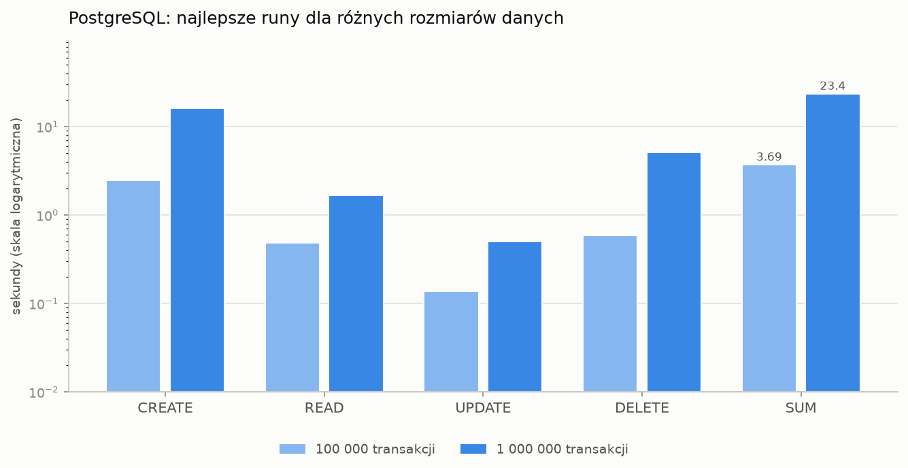
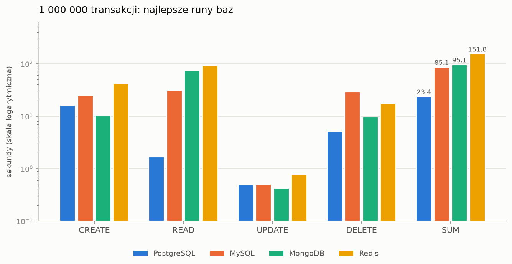
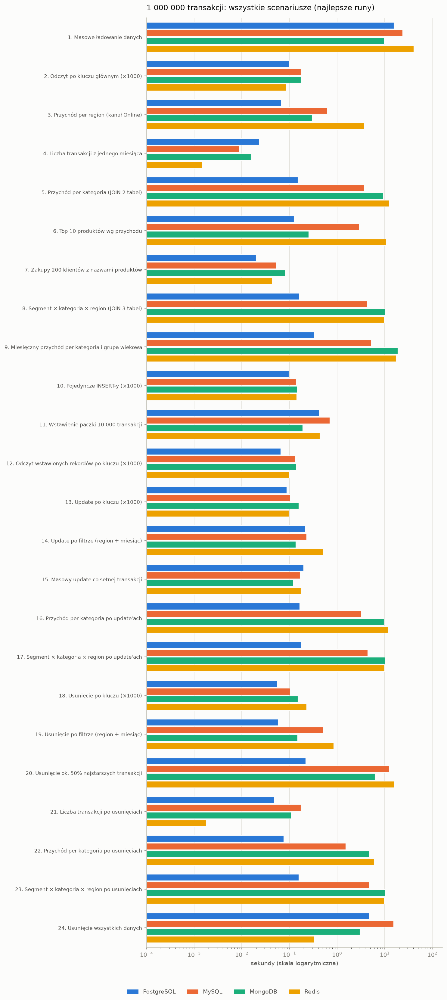

# Wyniki benchmarku

Źródło: `runs.csv`. Czasy w sekundach. R1–R3 to kolejne runy, `best*` to najlepszy run (kompletny run z najmniejszą sumą czasów wszystkich 24 scenariuszy; jeśli żaden run nie był kompletny, run z największą liczbą udanych scenariuszy). Tekst zamiast liczby oznacza, że scenariusz się nie udał: `timeout`, `oom`, `error` albo `skipped` (pominięty, bo wcześniejsza modyfikacja danych się nie udała); `DNF` w wierszu SUMA oznacza, że run nie został ukończony. Na wykresach krzyżyk (×) przy osi oznacza scenariusz, który się nie udał, z jego statusem. Skala wykresów jest logarytmiczna. Opis scenariuszy: [SCENARIOS.md](../../SCENARIOS.md).

## Tabele per baza

### PostgreSQL

| Operacja | 100k R1 | 100k R2 | 100k R3 | 100k best* | 1M R1 | 1M R2 | 1M R3 | 1M best* |
|---|---:|---:|---:|---:|---:|---:|---:|---:|
| CREATE (3) | 2.47 | 2.45 | 2.48 | **2.47** | 16.7 | 16.1 | 16.7 | **16.1** |
| READ (14) | 0.49 | 0.49 | 0.48 | **0.49** | 1.68 | 1.67 | 1.65 | **1.67** |
| UPDATE (3) | 0.14 | 0.16 | 0.15 | **0.14** | 0.51 | 0.51 | 0.50 | **0.51** |
| DELETE (4) | 0.59 | 0.60 | 0.66 | **0.59** | 5.18 | 5.12 | 5.00 | **5.12** |
| **SUMA (24)** | 3.69 | 3.70 | 3.77 | **3.69** | 24.0 | 23.4 | 23.9 | **23.4** |

### MySQL

| Operacja | 100k R1 | 100k R2 | 100k R3 | 100k best* | 1M R1 | 1M R2 | 1M R3 | 1M best* |
|---|---:|---:|---:|---:|---:|---:|---:|---:|
| CREATE (3) | 3.35 | 3.32 | 3.37 | **3.32** | 24.8 | 24.9 | 24.6 | **24.6** |
| READ (14) | 2.00 | 1.99 | 2.04 | **1.99** | 33.8 | 34.2 | 31.4 | **31.4** |
| UPDATE (3) | 0.15 | 0.15 | 0.46 | **0.15** | 0.51 | 0.52 | 0.50 | **0.50** |
| DELETE (4) | 1.88 | 1.82 | 1.69 | **1.82** | 26.3 | 27.6 | 28.6 | **28.6** |
| **SUMA (24)** | 7.38 | 7.28 | 7.57 | **7.28** | 85.5 | 87.2 | 85.1 | **85.1** |

### MongoDB

| Operacja | 100k R1 | 100k R2 | 100k R3 | 100k best* | 1M R1 | 1M R2 | 1M R3 | 1M best* |
|---|---:|---:|---:|---:|---:|---:|---:|---:|
| CREATE (3) | 1.45 | 1.44 | 1.41 | **1.44** | 10.1 | 10.3 | 11.0 | **10.1** |
| READ (14) | 8.25 | 7.99 | 8.18 | **7.99** | 74.9 | 74.8 | 76.2 | **74.9** |
| UPDATE (3) | 0.18 | 0.18 | 0.18 | **0.18** | 0.42 | 0.37 | 0.39 | **0.42** |
| DELETE (4) | 0.87 | 0.83 | 0.83 | **0.83** | 9.63 | 9.70 | 9.68 | **9.63** |
| **SUMA (24)** | 10.8 | 10.4 | 10.6 | **10.4** | 95.1 | 95.2 | 97.3 | **95.1** |

### Redis

| Operacja | 100k R1 | 100k R2 | 100k R3 | 100k best* | 1M R1 | 1M R2 | 1M R3 | 1M best* |
|---|---:|---:|---:|---:|---:|---:|---:|---:|
| CREATE (3) | 4.76 | 4.66 | 4.72 | **4.66** | 41.3 | 41.1 | 41.3 | **41.3** |
| READ (14) | 9.88 | 9.62 | 10.3 | **9.62** | 93.2 | 93.2 | 92.3 | **92.3** |
| UPDATE (3) | 0.14 | 0.22 | 0.24 | **0.22** | 0.80 | 0.76 | 0.78 | **0.78** |
| DELETE (4) | 2.05 | 2.05 | 2.13 | **2.05** | 17.2 | 17.5 | 17.3 | **17.3** |
| **SUMA (24)** | 16.8 | 16.6 | 17.4 | **16.6** | 152.5 | 152.6 | 151.8 | **151.8** |

## Porównanie baz (najlepsze runy)

### 100 000 transakcji

| Operacja | PostgreSQL | MySQL | MongoDB | Redis |
|---|---:|---:|---:|---:|
| CREATE (3) | 2.47 | 3.32 | **1.44** | 4.66 |
| READ (14) | **0.49** | 1.99 | 7.99 | 9.62 |
| UPDATE (3) | **0.14** | 0.15 | 0.18 | 0.22 |
| DELETE (4) | **0.59** | 1.82 | 0.83 | 2.05 |
| **SUMA (24)** | **3.69** | 7.28 | 10.4 | 16.6 |
| najlepszy run | run 1 | run 2 | run 2 | run 2 |

Wszystkie 24 scenariusze

| # | Scenariusz | Op. | Trudność | PostgreSQL | MySQL | MongoDB | Redis |
|---|---:|---:|---:|---:|---:|---:|---:|
| 1 | Masowe ładowanie danych | CREATE | heavy | 2.01 | 2.86 | **1.13** | 4.09 |
| 2 | Odczyt po kluczu głównym (×1000) | READ | easy | **0.07** | 0.13 | 0.15 | 0.09 |
| 3 | Przychód per region (kanał Online) | READ | easy | **0.02** | 0.03 | 0.04 | 0.38 |
| 4 | Liczba transakcji z jednego miesiąca | READ | easy | 0.00 | **0.00** | 0.01 | 0.00 |
| 5 | Przychód per kategoria (JOIN 2 tabel) | READ | medium | **0.05** | 0.16 | 0.91 | 1.24 |
| 6 | Top 10 produktów wg przychodu | READ | medium | **0.03** | 0.16 | 0.04 | 1.05 |
| 7 | Zakupy 200 klientów z nazwami produktów | READ | medium | **0.02** | 0.03 | 0.09 | 0.04 |
| 8 | Segment × kategoria × region (JOIN 3 tabel) | READ | heavy | **0.04** | 0.21 | 0.95 | 0.97 |
| 9 | Miesięczny przychód per kategoria i grupa wiekowa | READ | heavy | **0.08** | 0.37 | 1.90 | 1.65 |
| 10 | Pojedyncze INSERT-y (×1000) | CREATE | easy | **0.10** | 0.11 | 0.14 | 0.14 |
| 11 | Wstawienie paczki 10 000 transakcji | CREATE | medium | 0.36 | 0.35 | **0.18** | 0.42 |
| 12 | Odczyt wstawionych rekordów po kluczu (×1000) | READ | easy | **0.07** | 0.15 | 0.14 | 0.09 |
| 13 | Update po kluczu (×1000) | UPDATE | easy | 0.08 | 0.11 | 0.14 | **0.08** |
| 14 | Update po filtrze (region + miesiąc) | UPDATE | medium | 0.02 | 0.02 | **0.02** | 0.13 |
| 15 | Masowy update co setnej transakcji | UPDATE | heavy | 0.03 | 0.02 | **0.02** | 0.02 |
| 16 | Przychód per kategoria po update'ach | READ | medium | **0.03** | 0.18 | 1.07 | 1.33 |
| 17 | Segment × kategoria × region po update'ach | READ | heavy | **0.03** | 0.22 | 1.06 | 1.05 |
| 18 | Usunięcie po kluczu (×1000) | DELETE | easy | **0.06** | 0.09 | 0.16 | 0.16 |
| 19 | Usunięcie po filtrze (region + miesiąc) | DELETE | medium | **0.01** | 0.04 | 0.02 | 0.14 |
| 20 | Usunięcie ok. 50% najstarszych transakcji | DELETE | heavy | **0.03** | 0.58 | 0.33 | 1.72 |
| 21 | Liczba transakcji po usunięciach | READ | easy | 0.01 | 0.01 | 0.02 | **0.00** |
| 22 | Przychód per kategoria po usunięciach | READ | medium | **0.02** | 0.11 | 0.52 | 0.66 |
| 23 | Segment × kategoria × region po usunięciach | READ | heavy | **0.03** | 0.24 | 1.10 | 1.07 |
| 24 | Usunięcie wszystkich danych | DELETE | heavy | 0.50 | 1.10 | 0.31 | **0.03** |

### 1 000 000 transakcji

| Operacja | PostgreSQL | MySQL | MongoDB | Redis |
|---|---:|---:|---:|---:|
| CREATE (3) | 16.1 | 24.6 | **10.1** | 41.3 |
| READ (14) | **1.67** | 31.4 | 74.9 | 92.3 |
| UPDATE (3) | 0.51 | 0.50 | **0.42** | 0.78 |
| DELETE (4) | **5.12** | 28.6 | 9.63 | 17.3 |
| **SUMA (24)** | **23.4** | 85.1 | 95.1 | 151.8 |
| najlepszy run | run 2 | run 3 | run 1 | run 3 |

Wszystkie 24 scenariusze

| # | Scenariusz | Op. | Trudność | PostgreSQL | MySQL | MongoDB | Redis |
|---|---:|---:|---:|---:|---:|---:|---:|
| 1 | Masowe ładowanie danych | CREATE | heavy | 15.6 | 23.8 | **9.77** | 40.8 |
| 2 | Odczyt po kluczu głównym (×1000) | READ | easy | 0.10 | 0.17 | 0.17 | **0.09** |
| 3 | Przychód per region (kanał Online) | READ | easy | **0.07** | 0.63 | 0.30 | 3.78 |
| 4 | Liczba transakcji z jednego miesiąca | READ | easy | 0.02 | 0.01 | 0.02 | **0.00** |
| 5 | Przychód per kategoria (JOIN 2 tabel) | READ | medium | **0.15** | 3.71 | 9.41 | 12.5 |
| 6 | Top 10 produktów wg przychodu | READ | medium | **0.13** | 2.93 | 0.26 | 10.8 |
| 7 | Zakupy 200 klientów z nazwami produktów | READ | medium | **0.02** | 0.05 | 0.08 | 0.04 |
| 8 | Segment × kategoria × region (JOIN 3 tabel) | READ | heavy | **0.16** | 4.33 | 10.3 | 9.84 |
| 9 | Miesięczny przychód per kategoria i grupa wiekowa | READ | heavy | **0.33** | 5.26 | 19.0 | 17.3 |
| 10 | Pojedyncze INSERT-y (×1000) | CREATE | easy | **0.10** | 0.14 | 0.15 | 0.14 |
| 11 | Wstawienie paczki 10 000 transakcji | CREATE | medium | 0.43 | 0.71 | **0.19** | 0.44 |
| 12 | Odczyt wstawionych rekordów po kluczu (×1000) | READ | easy | **0.07** | 0.13 | 0.14 | 0.10 |
| 13 | Update po kluczu (×1000) | UPDATE | easy | **0.09** | 0.10 | 0.16 | 0.10 |
| 14 | Update po filtrze (region + miesiąc) | UPDATE | medium | 0.22 | 0.23 | **0.14** | 0.51 |
| 15 | Masowy update co setnej transakcji | UPDATE | heavy | 0.20 | 0.17 | **0.12** | 0.17 |
| 16 | Przychód per kategoria po update'ach | READ | medium | **0.17** | 3.25 | 9.66 | 12.1 |
| 17 | Segment × kategoria × region po update'ach | READ | heavy | **0.18** | 4.45 | 10.4 | 10.1 |
| 18 | Usunięcie po kluczu (×1000) | DELETE | easy | **0.06** | 0.10 | 0.15 | 0.23 |
| 19 | Usunięcie po filtrze (region + miesiąc) | DELETE | medium | **0.06** | 0.52 | 0.15 | 0.85 |
| 20 | Usunięcie ok. 50% najstarszych transakcji | DELETE | heavy | **0.22** | 12.4 | 6.31 | 15.9 |
| 21 | Liczba transakcji po usunięciach | READ | easy | 0.05 | 0.17 | 0.11 | **0.00** |
| 22 | Przychód per kategoria po usunięciach | READ | medium | **0.08** | 1.53 | 4.80 | 5.96 |
| 23 | Segment × kategoria × region po usunięciach | READ | heavy | **0.16** | 4.76 | 10.3 | 9.82 |
| 24 | Usunięcie wszystkich danych | DELETE | heavy | 4.78 | 15.6 | 3.02 | **0.33** |

## Powtarzalność runów

Suma czasów wszystkich 24 scenariuszy w każdym runie (sekundy) i rozrzut między kompletnymi runami: (największy − najmniejszy) / najmniejszy. Mały rozrzut znaczy, że różnice między bazami są większe niż szum pomiaru.

### 100 000 transakcji

| Baza | run 1 | run 2 | run 3 | rozrzut |
|---|---:|---:|---:|---:|
| PostgreSQL | 3.69 | 3.70 | 3.77 | 2% |
| MySQL | 7.38 | 7.28 | 7.57 | 4% |
| MongoDB | 10.8 | 10.4 | 10.6 | 3% |
| Redis | 16.8 | 16.6 | 17.4 | 5% |

### 1 000 000 transakcji

| Baza | run 1 | run 2 | run 3 | rozrzut |
|---|---:|---:|---:|---:|
| PostgreSQL | 24.0 | 23.4 | 23.9 | 3% |
| MySQL | 85.5 | 87.2 | 85.1 | 2% |
| MongoDB | 95.1 | 95.2 | 97.3 | 2% |
| Redis | 152.5 | 152.6 | 151.8 | 1% |

## Załącznik: wszystkie scenariusze w każdym runie

PostgreSQL

| # | Scenariusz | 100k R1 | 100k R2 | 100k R3 | 1M R1 | 1M R2 | 1M R3 |
|---|---:|---:|---:|---:|---:|---:|---:|
| 1 | Masowe ładowanie danych | 2.01 | 1.93 | 1.95 | 16.2 | 15.6 | 16.2 |
| 2 | Odczyt po kluczu głównym (×1000) | 0.07 | 0.07 | 0.07 | 0.10 | 0.10 | 0.08 |
| 3 | Przychód per region (kanał Online) | 0.02 | 0.02 | 0.02 | 0.07 | 0.07 | 0.07 |
| 4 | Liczba transakcji z jednego miesiąca | 0.00 | 0.00 | 0.00 | 0.02 | 0.02 | 0.02 |
| 5 | Przychód per kategoria (JOIN 2 tabel) | 0.05 | 0.03 | 0.03 | 0.14 | 0.15 | 0.13 |
| 6 | Top 10 produktów wg przychodu | 0.03 | 0.03 | 0.03 | 0.12 | 0.13 | 0.12 |
| 7 | Zakupy 200 klientów z nazwami produktów | 0.02 | 0.02 | 0.02 | 0.02 | 0.02 | 0.02 |
| 8 | Segment × kategoria × region (JOIN 3 tabel) | 0.04 | 0.03 | 0.04 | 0.16 | 0.16 | 0.16 |
| 9 | Miesięczny przychód per kategoria i grupa wiekowa | 0.08 | 0.08 | 0.07 | 0.33 | 0.33 | 0.35 |
| 10 | Pojedyncze INSERT-y (×1000) | 0.10 | 0.09 | 0.10 | 0.10 | 0.10 | 0.10 |
| 11 | Wstawienie paczki 10 000 transakcji | 0.36 | 0.43 | 0.43 | 0.41 | 0.43 | 0.44 |
| 12 | Odczyt wstawionych rekordów po kluczu (×1000) | 0.07 | 0.09 | 0.08 | 0.07 | 0.07 | 0.07 |
| 13 | Update po kluczu (×1000) | 0.08 | 0.10 | 0.09 | 0.10 | 0.09 | 0.10 |
| 14 | Update po filtrze (region + miesiąc) | 0.02 | 0.02 | 0.02 | 0.20 | 0.22 | 0.20 |
| 15 | Masowy update co setnej transakcji | 0.03 | 0.03 | 0.04 | 0.20 | 0.20 | 0.20 |
| 16 | Przychód per kategoria po update'ach | 0.03 | 0.03 | 0.03 | 0.17 | 0.17 | 0.17 |
| 17 | Segment × kategoria × region po update'ach | 0.03 | 0.03 | 0.03 | 0.18 | 0.18 | 0.18 |
| 18 | Usunięcie po kluczu (×1000) | 0.06 | 0.06 | 0.06 | 0.05 | 0.06 | 0.05 |
| 19 | Usunięcie po filtrze (region + miesiąc) | 0.01 | 0.01 | 0.01 | 0.06 | 0.06 | 0.06 |
| 20 | Usunięcie ok. 50% najstarszych transakcji | 0.03 | 0.03 | 0.03 | 0.28 | 0.22 | 0.24 |
| 21 | Liczba transakcji po usunięciach | 0.01 | 0.01 | 0.01 | 0.04 | 0.05 | 0.04 |
| 22 | Przychód per kategoria po usunięciach | 0.02 | 0.02 | 0.02 | 0.08 | 0.08 | 0.08 |
| 23 | Segment × kategoria × region po usunięciach | 0.03 | 0.03 | 0.03 | 0.17 | 0.16 | 0.16 |
| 24 | Usunięcie wszystkich danych | 0.50 | 0.51 | 0.55 | 4.79 | 4.78 | 4.65 |

MySQL

| # | Scenariusz | 100k R1 | 100k R2 | 100k R3 | 1M R1 | 1M R2 | 1M R3 |
|---|---:|---:|---:|---:|---:|---:|---:|
| 1 | Masowe ładowanie danych | 2.93 | 2.86 | 2.88 | 24.1 | 24.1 | 23.8 |
| 2 | Odczyt po kluczu głównym (×1000) | 0.14 | 0.13 | 0.12 | 0.17 | 0.17 | 0.17 |
| 3 | Przychód per region (kanał Online) | 0.03 | 0.03 | 0.03 | 0.52 | 0.52 | 0.63 |
| 4 | Liczba transakcji z jednego miesiąca | 0.00 | 0.00 | 0.00 | 0.01 | 0.01 | 0.01 |
| 5 | Przychód per kategoria (JOIN 2 tabel) | 0.15 | 0.16 | 0.18 | 3.46 | 3.90 | 3.71 |
| 6 | Top 10 produktów wg przychodu | 0.16 | 0.16 | 0.17 | 3.01 | 2.94 | 2.93 |
| 7 | Zakupy 200 klientów z nazwami produktów | 0.03 | 0.03 | 0.03 | 0.05 | 0.06 | 0.05 |
| 8 | Segment × kategoria × region (JOIN 3 tabel) | 0.20 | 0.21 | 0.21 | 4.18 | 4.37 | 4.33 |
| 9 | Miesięczny przychód per kategoria i grupa wiekowa | 0.37 | 0.37 | 0.37 | 5.90 | 6.00 | 5.26 |
| 10 | Pojedyncze INSERT-y (×1000) | 0.13 | 0.11 | 0.11 | 0.14 | 0.14 | 0.14 |
| 11 | Wstawienie paczki 10 000 transakcji | 0.29 | 0.35 | 0.37 | 0.53 | 0.74 | 0.71 |
| 12 | Odczyt wstawionych rekordów po kluczu (×1000) | 0.13 | 0.15 | 0.13 | 0.16 | 0.15 | 0.13 |
| 13 | Update po kluczu (×1000) | 0.10 | 0.11 | 0.42 | 0.11 | 0.13 | 0.10 |
| 14 | Update po filtrze (region + miesiąc) | 0.02 | 0.02 | 0.02 | 0.23 | 0.22 | 0.23 |
| 15 | Masowy update co setnej transakcji | 0.03 | 0.02 | 0.02 | 0.17 | 0.16 | 0.17 |
| 16 | Przychód per kategoria po update'ach | 0.18 | 0.18 | 0.19 | 3.34 | 3.26 | 3.25 |
| 17 | Segment × kategoria × region po update'ach | 0.22 | 0.22 | 0.23 | 4.94 | 4.81 | 4.45 |
| 18 | Usunięcie po kluczu (×1000) | 0.13 | 0.09 | 0.09 | 0.12 | 0.10 | 0.10 |
| 19 | Usunięcie po filtrze (region + miesiąc) | 0.05 | 0.04 | 0.03 | 0.58 | 0.46 | 0.52 |
| 20 | Usunięcie ok. 50% najstarszych transakcji | 0.51 | 0.58 | 0.53 | 11.0 | 11.8 | 12.4 |
| 21 | Liczba transakcji po usunięciach | 0.01 | 0.01 | 0.01 | 0.16 | 0.21 | 0.17 |
| 22 | Przychód per kategoria po usunięciach | 0.12 | 0.11 | 0.12 | 3.83 | 3.75 | 1.53 |
| 23 | Segment × kategoria × region po usunięciach | 0.25 | 0.24 | 0.25 | 4.09 | 4.08 | 4.76 |
| 24 | Usunięcie wszystkich danych | 1.18 | 1.10 | 1.04 | 14.6 | 15.2 | 15.6 |

MongoDB

| # | Scenariusz | 100k R1 | 100k R2 | 100k R3 | 1M R1 | 1M R2 | 1M R3 |
|---|---:|---:|---:|---:|---:|---:|---:|
| 1 | Masowe ładowanie danych | 1.16 | 1.13 | 1.08 | 9.77 | 10.0 | 10.7 |
| 2 | Odczyt po kluczu głównym (×1000) | 0.15 | 0.15 | 0.16 | 0.17 | 0.14 | 0.14 |
| 3 | Przychód per region (kanał Online) | 0.04 | 0.04 | 0.04 | 0.30 | 0.28 | 0.27 |
| 4 | Liczba transakcji z jednego miesiąca | 0.01 | 0.01 | 0.01 | 0.02 | 0.02 | 0.02 |
| 5 | Przychód per kategoria (JOIN 2 tabel) | 0.96 | 0.91 | 0.93 | 9.41 | 9.21 | 10.3 |
| 6 | Top 10 produktów wg przychodu | 0.04 | 0.04 | 0.04 | 0.26 | 0.25 | 0.27 |
| 7 | Zakupy 200 klientów z nazwami produktów | 0.08 | 0.09 | 0.09 | 0.08 | 0.08 | 0.09 |
| 8 | Segment × kategoria × region (JOIN 3 tabel) | 1.00 | 0.95 | 1.00 | 10.3 | 10.4 | 10.6 |
| 9 | Miesięczny przychód per kategoria i grupa wiekowa | 1.96 | 1.90 | 1.93 | 19.0 | 19.0 | 18.9 |
| 10 | Pojedyncze INSERT-y (×1000) | 0.16 | 0.14 | 0.14 | 0.15 | 0.15 | 0.15 |
| 11 | Wstawienie paczki 10 000 transakcji | 0.14 | 0.18 | 0.19 | 0.19 | 0.19 | 0.19 |
| 12 | Odczyt wstawionych rekordów po kluczu (×1000) | 0.14 | 0.14 | 0.14 | 0.14 | 0.19 | 0.14 |
| 13 | Update po kluczu (×1000) | 0.14 | 0.14 | 0.14 | 0.16 | 0.15 | 0.16 |
| 14 | Update po filtrze (region + miesiąc) | 0.02 | 0.02 | 0.02 | 0.14 | 0.12 | 0.13 |
| 15 | Masowy update co setnej transakcji | 0.02 | 0.02 | 0.02 | 0.12 | 0.10 | 0.10 |
| 16 | Przychód per kategoria po update'ach | 1.06 | 1.07 | 1.06 | 9.66 | 9.69 | 9.80 |
| 17 | Segment × kategoria × region po update'ach | 1.12 | 1.06 | 1.08 | 10.4 | 10.5 | 10.4 |
| 18 | Usunięcie po kluczu (×1000) | 0.14 | 0.16 | 0.14 | 0.15 | 0.14 | 0.16 |
| 19 | Usunięcie po filtrze (region + miesiąc) | 0.02 | 0.02 | 0.02 | 0.15 | 0.15 | 0.15 |
| 20 | Usunięcie ok. 50% najstarszych transakcji | 0.34 | 0.33 | 0.34 | 6.31 | 6.44 | 6.21 |
| 21 | Liczba transakcji po usunięciach | 0.02 | 0.02 | 0.02 | 0.11 | 0.11 | 0.11 |
| 22 | Przychód per kategoria po usunięciach | 0.52 | 0.52 | 0.56 | 4.80 | 4.81 | 4.84 |
| 23 | Segment × kategoria × region po usunięciach | 1.16 | 1.10 | 1.13 | 10.3 | 10.2 | 10.3 |
| 24 | Usunięcie wszystkich danych | 0.36 | 0.31 | 0.34 | 3.02 | 2.96 | 3.16 |

Redis

| # | Scenariusz | 100k R1 | 100k R2 | 100k R3 | 1M R1 | 1M R2 | 1M R3 |
|---|---:|---:|---:|---:|---:|---:|---:|
| 1 | Masowe ładowanie danych | 4.19 | 4.09 | 4.09 | 40.8 | 40.5 | 40.8 |
| 2 | Odczyt po kluczu głównym (×1000) | 0.11 | 0.09 | 0.08 | 0.09 | 0.11 | 0.09 |
| 3 | Przychód per region (kanał Online) | 0.35 | 0.38 | 0.39 | 3.58 | 3.60 | 3.78 |
| 4 | Liczba transakcji z jednego miesiąca | 0.00 | 0.00 | 0.00 | 0.00 | 0.00 | 0.00 |
| 5 | Przychód per kategoria (JOIN 2 tabel) | 1.17 | 1.24 | 1.23 | 12.7 | 12.5 | 12.5 |
| 6 | Top 10 produktów wg przychodu | 1.09 | 1.05 | 1.31 | 10.6 | 10.6 | 10.8 |
| 7 | Zakupy 200 klientów z nazwami produktów | 0.04 | 0.04 | 0.04 | 0.04 | 0.05 | 0.04 |
| 8 | Segment × kategoria × region (JOIN 3 tabel) | 0.95 | 0.97 | 1.13 | 9.76 | 9.89 | 9.84 |
| 9 | Miesięczny przychód per kategoria i grupa wiekowa | 1.72 | 1.65 | 1.75 | 17.5 | 17.8 | 17.3 |
| 10 | Pojedyncze INSERT-y (×1000) | 0.15 | 0.14 | 0.15 | 0.15 | 0.15 | 0.14 |
| 11 | Wstawienie paczki 10 000 transakcji | 0.42 | 0.42 | 0.47 | 0.43 | 0.48 | 0.44 |
| 12 | Odczyt wstawionych rekordów po kluczu (×1000) | 0.10 | 0.09 | 0.10 | 0.08 | 0.10 | 0.10 |
| 13 | Update po kluczu (×1000) | 0.07 | 0.08 | 0.09 | 0.07 | 0.08 | 0.10 |
| 14 | Update po filtrze (region + miesiąc) | 0.05 | 0.13 | 0.13 | 0.53 | 0.51 | 0.51 |
| 15 | Masowy update co setnej transakcji | 0.01 | 0.02 | 0.02 | 0.20 | 0.18 | 0.17 |
| 16 | Przychód per kategoria po update'ach | 1.59 | 1.33 | 1.41 | 12.1 | 12.1 | 12.1 |
| 17 | Segment × kategoria × region po update'ach | 1.09 | 1.05 | 1.10 | 11.0 | 10.2 | 10.1 |
| 18 | Usunięcie po kluczu (×1000) | 0.18 | 0.16 | 0.17 | 0.23 | 0.22 | 0.23 |
| 19 | Usunięcie po filtrze (region + miesiąc) | 0.06 | 0.14 | 0.14 | 0.75 | 0.83 | 0.85 |
| 20 | Usunięcie ok. 50% najstarszych transakcji | 1.77 | 1.72 | 1.79 | 15.9 | 16.2 | 15.9 |
| 21 | Liczba transakcji po usunięciach | 0.00 | 0.00 | 0.00 | 0.00 | 0.00 | 0.00 |
| 22 | Przychód per kategoria po usunięciach | 0.66 | 0.66 | 0.69 | 6.04 | 6.07 | 5.96 |
| 23 | Segment × kategoria × region po usunięciach | 1.00 | 1.07 | 1.07 | 9.72 | 10.2 | 9.82 |
| 24 | Usunięcie wszystkich danych | 0.03 | 0.03 | 0.04 | 0.34 | 0.33 | 0.33 |

