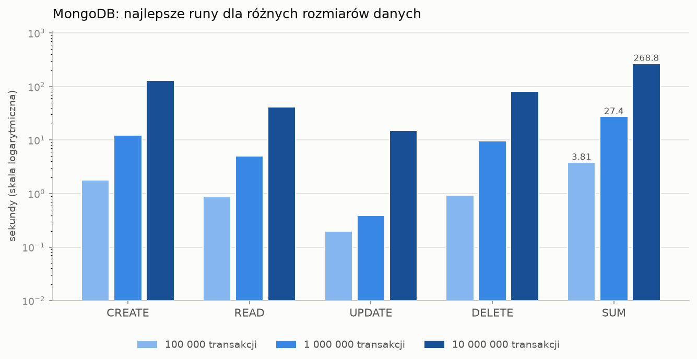
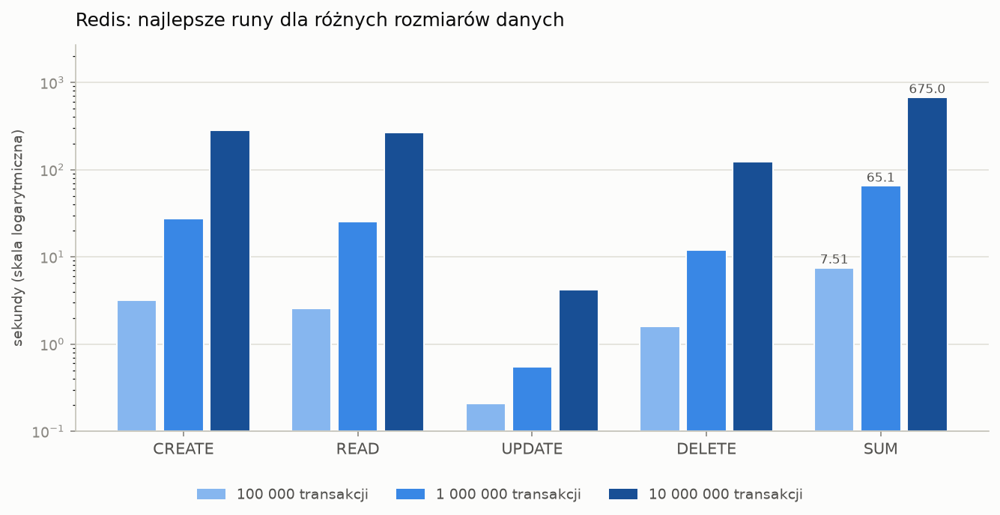
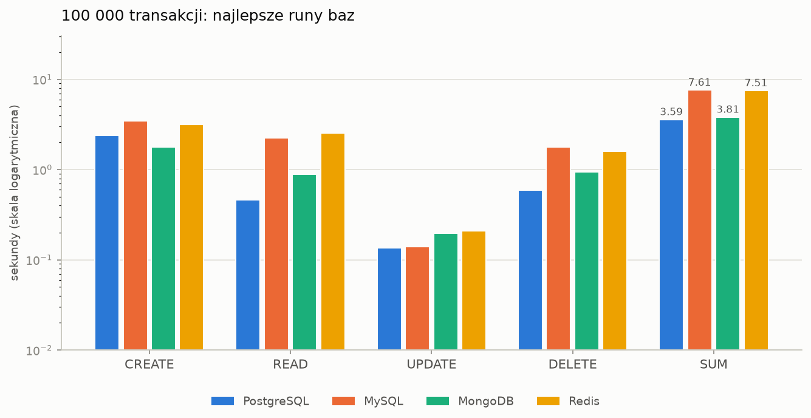
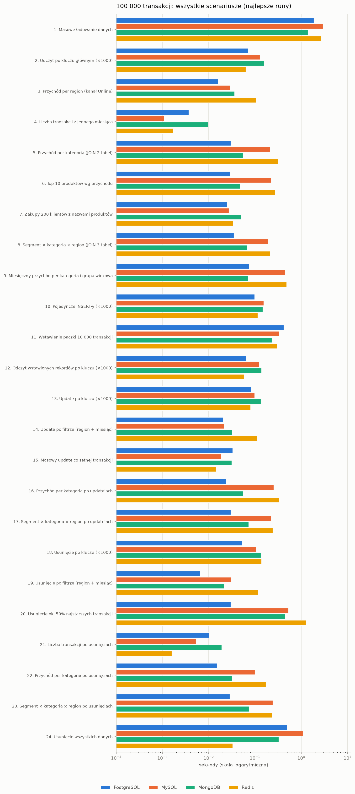

# Wyniki benchmarku

Źródło: `runs.csv`. Czasy w sekundach. R1–R3 to kolejne runy, `best*` to najlepszy run (kompletny run z najmniejszą sumą czasów wszystkich 24 scenariuszy; jeśli żaden run nie był kompletny, run z największą liczbą udanych scenariuszy). Tekst zamiast liczby oznacza, że scenariusz się nie udał: `timeout`, `oom`, `error` albo `skipped` (pominięty, bo wcześniejsza modyfikacja danych się nie udała); `DNF` w wierszu SUMA oznacza, że run nie został ukończony. Na wykresach krzyżyk (×) przy osi oznacza scenariusz, który się nie udał, z jego statusem. Skala wykresów jest logarytmiczna. Opis scenariuszy: [SCENARIOS.md](../../SCENARIOS.md).

## Tabele per baza

### PostgreSQL

| Operacja | 100k R1 | 100k R2 | 100k R3 | 100k best* | 1M R1 | 1M R2 | 1M R3 | 1M best* | 10M R1 | 10M R2 | 10M R3 | 10M best* |
|---|---:|---:|---:|---:|---:|---:|---:|---:|---:|---:|---:|---:|
| CREATE (3) | 2.39 | 2.40 | 2.41 | **2.40** | 16.1 | 15.9 | 15.9 | **15.9** | 175.2 | 176.9 | 177.5 | **175.2** |
| READ (14) | 0.45 | 0.46 | 0.51 | **0.46** | 1.52 | 1.55 | 1.56 | **1.55** | 19.2 | 19.7 | 19.5 | **19.2** |
| UPDATE (3) | 0.45 | 0.14 | 0.14 | **0.14** | 0.41 | 0.42 | 0.42 | **0.42** | 6.55 | 6.90 | 6.57 | **6.55** |
| DELETE (4) | 0.60 | 0.59 | 0.59 | **0.59** | 4.86 | 4.87 | 4.96 | **4.87** | 55.4 | 56.8 | 56.2 | **55.4** |
| **SUMA (24)** | 3.90 | 3.59 | 3.65 | **3.59** | 22.9 | 22.8 | 22.8 | **22.8** | 256.4 | 260.3 | 259.7 | **256.4** |

### MySQL

| Operacja | 100k R1 | 100k R2 | 100k R3 | 100k best* | 1M R1 | 1M R2 | 1M R3 | 1M best* | 10M R1 | 10M R2 | 10M R3 | 10M best* |
|---|---:|---:|---:|---:|---:|---:|---:|---:|---:|---:|---:|---:|
| CREATE (3) | 3.47 | 3.79 | 3.46 | **3.47** | 24.7 | 24.7 | 24.5 | **24.5** | 252.7 | 237.9 | 270.3 | **237.9** |
| READ (14) | 2.23 | 2.27 | 2.28 | **2.23** | 22.0 | 22.1 | 22.1 | **22.1** | 310.4 | 302.6 | 303.8 | **302.6** |
| UPDATE (3) | 0.14 | 0.13 | 0.13 | **0.14** | 0.43 | 0.44 | 0.47 | **0.47** | 3.55 | 3.51 | 3.41 | **3.51** |
| DELETE (4) | 1.77 | 1.73 | 1.76 | **1.77** | 17.3 | 17.0 | 16.9 | **16.9** | 207.1 | 204.3 | 203.0 | **204.3** |
| **SUMA (24)** | 7.61 | 7.91 | 7.63 | **7.61** | 64.4 | 64.3 | 64.0 | **64.0** | 773.7 | 748.2 | 780.5 | **748.2** |

### MongoDB

| Operacja | 100k R1 | 100k R2 | 100k R3 | 100k best* | 1M R1 | 1M R2 | 1M R3 | 1M best* | 10M R1 | 10M R2 | 10M R3 | 10M best* |
|---|---:|---:|---:|---:|---:|---:|---:|---:|---:|---:|---:|---:|
| CREATE (3) | 1.79 | 1.84 | 1.83 | **1.79** | 12.3 | 12.4 | 12.4 | **12.3** | 130.4 | 131.5 | 131.7 | **130.4** |
| READ (14) | 0.89 | 0.87 | 0.96 | **0.89** | 5.04 | 5.15 | 5.10 | **5.04** | 41.4 | 41.8 | 41.7 | **41.4** |
| UPDATE (3) | 0.20 | 0.17 | 0.17 | **0.20** | 0.39 | 0.35 | 0.50 | **0.39** | 14.9 | 14.6 | 14.6 | **14.9** |
| DELETE (4) | 0.94 | 0.97 | 0.95 | **0.94** | 9.61 | 10.8 | 10.1 | **9.61** | 82.0 | 97.5 | 84.4 | **82.0** |
| **SUMA (24)** | 3.81 | 3.85 | 3.91 | **3.81** | 27.4 | 28.8 | 28.0 | **27.4** | 268.8 | 285.3 | 272.4 | **268.8** |

### Redis

| Operacja | 100k R1 | 100k R2 | 100k R3 | 100k best* | 1M R1 | 1M R2 | 1M R3 | 1M best* | 10M R1 | 10M R2 | 10M R3 | 10M best* |
|---|---:|---:|---:|---:|---:|---:|---:|---:|---:|---:|---:|---:|
| CREATE (3) | 3.16 | 3.31 | 3.16 | **3.16** | 27.6 | 27.3 | 27.4 | **27.4** | 282.9 | 289.5 | 284.7 | **282.9** |
| READ (14) | 2.55 | 2.65 | 2.68 | **2.55** | 25.4 | 25.3 | 25.2 | **25.2** | 264.3 | 262.2 | 265.7 | **264.3** |
| UPDATE (3) | 0.21 | 0.19 | 0.20 | **0.21** | 0.51 | 0.51 | 0.55 | **0.55** | 4.20 | 4.14 | 4.19 | **4.20** |
| DELETE (4) | 1.59 | 1.57 | 1.56 | **1.59** | 12.1 | 11.9 | 11.9 | **11.9** | 123.7 | 124.0 | 124.9 | **123.7** |
| **SUMA (24)** | 7.51 | 7.72 | 7.60 | **7.51** | 65.6 | 65.1 | 65.1 | **65.1** | 675.0 | 679.9 | 679.5 | **675.0** |

## Porównanie baz (najlepsze runy)

### 100 000 transakcji

| Operacja | PostgreSQL | MySQL | MongoDB | Redis |
|---|---:|---:|---:|---:|
| CREATE (3) | 2.40 | 3.47 | **1.79** | 3.16 |
| READ (14) | **0.46** | 2.23 | 0.89 | 2.55 |
| UPDATE (3) | **0.14** | 0.14 | 0.20 | 0.21 |
| DELETE (4) | **0.59** | 1.77 | 0.94 | 1.59 |
| **SUMA (24)** | **3.59** | 7.61 | 3.81 | 7.51 |
| najlepszy run | run 2 | run 1 | run 1 | run 1 |

Wszystkie 24 scenariusze

| # | Scenariusz | Op. | Trudność | PostgreSQL | MySQL | MongoDB | Redis |
|---|---:|---:|---:|---:|---:|---:|---:|
| 1 | Masowe ładowanie danych | CREATE | heavy | 1.88 | 2.97 | **1.41** | 2.74 |
| 2 | Odczyt po kluczu głównym (×1000) | READ | easy | 0.07 | 0.13 | 0.16 | **0.06** |
| 3 | Przychód per region (kanał Online) | READ | easy | **0.02** | 0.03 | 0.04 | 0.11 |
| 4 | Liczba transakcji z jednego miesiąca | READ | easy | 0.00 | **0.00** | 0.01 | 0.00 |
| 5 | Przychód per kategoria (JOIN 2 tabel) | READ | medium | **0.03** | 0.22 | 0.06 | 0.32 |
| 6 | Top 10 produktów wg przychodu | READ | medium | **0.03** | 0.23 | 0.05 | 0.27 |
| 7 | Zakupy 200 klientów z nazwami produktów | READ | medium | **0.03** | 0.03 | 0.05 | 0.03 |
| 8 | Segment × kategoria × region (JOIN 3 tabel) | READ | heavy | **0.04** | 0.20 | 0.07 | 0.21 |
| 9 | Miesięczny przychód per kategoria i grupa wiekowa | READ | heavy | 0.07 | 0.45 | **0.07** | 0.48 |
| 10 | Pojedyncze INSERT-y (×1000) | CREATE | easy | **0.10** | 0.16 | 0.15 | 0.12 |
| 11 | Wstawienie paczki 10 000 transakcji | CREATE | medium | 0.42 | 0.34 | **0.23** | 0.30 |
| 12 | Odczyt wstawionych rekordów po kluczu (×1000) | READ | easy | 0.07 | 0.12 | 0.14 | **0.06** |
| 13 | Update po kluczu (×1000) | UPDATE | easy | 0.08 | 0.10 | 0.13 | **0.08** |
| 14 | Update po filtrze (region + miesiąc) | UPDATE | medium | **0.02** | 0.02 | 0.03 | 0.11 |
| 15 | Masowy update co setnej transakcji | UPDATE | heavy | 0.03 | 0.02 | 0.03 | **0.01** |
| 16 | Przychód per kategoria po update'ach | READ | medium | **0.02** | 0.26 | 0.06 | 0.34 |
| 17 | Segment × kategoria × region po update'ach | READ | heavy | **0.03** | 0.22 | 0.07 | 0.24 |
| 18 | Usunięcie po kluczu (×1000) | DELETE | easy | **0.05** | 0.11 | 0.14 | 0.14 |
| 19 | Usunięcie po filtrze (region + miesiąc) | DELETE | medium | **0.01** | 0.03 | 0.02 | 0.12 |
| 20 | Usunięcie ok. 50% najstarszych transakcji | DELETE | heavy | **0.03** | 0.53 | 0.45 | 1.30 |
| 21 | Liczba transakcji po usunięciach | READ | easy | 0.01 | 0.01 | 0.02 | **0.00** |
| 22 | Przychód per kategoria po usunięciach | READ | medium | **0.02** | 0.10 | 0.03 | 0.17 |
| 23 | Segment × kategoria × region po usunięciach | READ | heavy | **0.03** | 0.24 | 0.07 | 0.24 |
| 24 | Usunięcie wszystkich danych | DELETE | heavy | 0.50 | 1.10 | 0.33 | **0.03** |

### 1 000 000 transakcji

| Operacja | PostgreSQL | MySQL | MongoDB | Redis |
|---|---:|---:|---:|---:|
| CREATE (3) | 15.9 | 24.5 | **12.3** | 27.4 |
| READ (14) | **1.55** | 22.1 | 5.04 | 25.2 |
| UPDATE (3) | 0.42 | 0.47 | **0.39** | 0.55 |
| DELETE (4) | **4.87** | 16.9 | 9.61 | 11.9 |
| **SUMA (24)** | **22.8** | 64.0 | 27.4 | 65.1 |
| najlepszy run | run 2 | run 3 | run 1 | run 3 |

Wszystkie 24 scenariusze

| # | Scenariusz | Op. | Trudność | PostgreSQL | MySQL | MongoDB | Redis |
|---|---:|---:|---:|---:|---:|---:|---:|
| 1 | Masowe ładowanie danych | CREATE | heavy | 15.5 | 24.0 | **12.0** | 27.0 |
| 2 | Odczyt po kluczu głównym (×1000) | READ | easy | 0.07 | 0.13 | 0.16 | **0.07** |
| 3 | Przychód per region (kanał Online) | READ | easy | **0.06** | 0.28 | 0.27 | 1.04 |
| 4 | Liczba transakcji z jednego miesiąca | READ | easy | 0.02 | 0.01 | 0.02 | **0.00** |
| 5 | Przychód per kategoria (JOIN 2 tabel) | READ | medium | **0.12** | 2.68 | 0.40 | 3.15 |
| 6 | Top 10 produktów wg przychodu | READ | medium | **0.13** | 2.78 | 0.36 | 2.70 |
| 7 | Zakupy 200 klientów z nazwami produktów | READ | medium | **0.02** | 0.03 | 0.05 | 0.04 |
| 8 | Segment × kategoria × region (JOIN 3 tabel) | READ | heavy | **0.16** | 2.11 | 0.80 | 2.56 |
| 9 | Miesięczny przychód per kategoria i grupa wiekowa | READ | heavy | **0.33** | 4.68 | 0.59 | 5.54 |
| 10 | Pojedyncze INSERT-y (×1000) | CREATE | easy | **0.10** | 0.17 | 0.15 | 0.12 |
| 11 | Wstawienie paczki 10 000 transakcji | CREATE | medium | 0.37 | 0.30 | **0.18** | 0.32 |
| 12 | Odczyt wstawionych rekordów po kluczu (×1000) | READ | easy | **0.06** | 0.15 | 0.14 | 0.06 |
| 13 | Update po kluczu (×1000) | UPDATE | easy | 0.10 | 0.10 | 0.15 | **0.08** |
| 14 | Update po filtrze (region + miesiąc) | UPDATE | medium | 0.16 | 0.22 | **0.11** | 0.39 |
| 15 | Masowy update co setnej transakcji | UPDATE | heavy | 0.16 | 0.15 | 0.13 | **0.08** |
| 16 | Przychód per kategoria po update'ach | READ | medium | **0.14** | 2.85 | 0.47 | 3.17 |
| 17 | Segment × kategoria × region po update'ach | READ | heavy | **0.16** | 2.19 | 0.75 | 2.58 |
| 18 | Usunięcie po kluczu (×1000) | DELETE | easy | **0.06** | 0.10 | 0.17 | 0.14 |
| 19 | Usunięcie po filtrze (region + miesiąc) | DELETE | medium | **0.03** | 0.30 | 0.14 | 0.42 |
| 20 | Usunięcie ok. 50% najstarszych transakcji | DELETE | heavy | **0.23** | 5.63 | 6.31 | 11.0 |
| 21 | Liczba transakcji po usunięciach | READ | easy | 0.05 | 0.05 | 0.09 | **0.00** |
| 22 | Przychód per kategoria po usunięciach | READ | medium | **0.08** | 1.74 | 0.21 | 1.76 |
| 23 | Segment × kategoria × region po usunięciach | READ | heavy | **0.15** | 2.45 | 0.74 | 2.54 |
| 24 | Usunięcie wszystkich danych | DELETE | heavy | 4.56 | 10.9 | 2.99 | **0.35** |

### 10 000 000 transakcji

| Operacja | PostgreSQL | MySQL | MongoDB | Redis |
|---|---:|---:|---:|---:|
| CREATE (3) | 175.2 | 237.9 | **130.4** | 282.9 |
| READ (14) | **19.2** | 302.6 | 41.4 | 264.3 |
| UPDATE (3) | 6.55 | **3.51** | 14.9 | 4.20 |
| DELETE (4) | **55.4** | 204.3 | 82.0 | 123.7 |
| **SUMA (24)** | **256.4** | 748.2 | 268.8 | 675.0 |
| najlepszy run | run 1 | run 2 | run 1 | run 1 |

Wszystkie 24 scenariusze

| # | Scenariusz | Op. | Trudność | PostgreSQL | MySQL | MongoDB | Redis |
|---|---:|---:|---:|---:|---:|---:|---:|
| 1 | Masowe ładowanie danych | CREATE | heavy | 174.7 | 237.3 | **130.1** | 282.5 |
| 2 | Odczyt po kluczu głównym (×1000) | READ | easy | 0.10 | 0.15 | 0.29 | **0.07** |
| 3 | Przychód per region (kanał Online) | READ | easy | **0.57** | 2.83 | 3.72 | 11.0 |
| 4 | Liczba transakcji z jednego miesiąca | READ | easy | 0.32 | 0.07 | 0.06 | **0.00** |
| 5 | Przychód per kategoria (JOIN 2 tabel) | READ | medium | **1.30** | 28.3 | 5.13 | 33.1 |
| 6 | Top 10 produktów wg przychodu | READ | medium | **1.32** | 37.2 | 4.48 | 29.2 |
| 7 | Zakupy 200 klientów z nazwami produktów | READ | medium | 0.03 | **0.03** | 0.06 | 0.04 |
| 8 | Segment × kategoria × region (JOIN 3 tabel) | READ | heavy | **1.96** | 43.0 | 4.79 | 27.5 |
| 9 | Miesięczny przychód per kategoria i grupa wiekowa | READ | heavy | **4.14** | 57.8 | 7.05 | 59.3 |
| 10 | Pojedyncze INSERT-y (×1000) | CREATE | easy | 0.13 | 0.29 | 0.18 | **0.12** |
| 11 | Wstawienie paczki 10 000 transakcji | CREATE | medium | 0.42 | 0.31 | **0.19** | 0.27 |
| 12 | Odczyt wstawionych rekordów po kluczu (×1000) | READ | easy | 0.08 | 0.13 | 0.14 | **0.06** |
| 13 | Update po kluczu (×1000) | UPDATE | easy | 0.11 | 0.10 | 0.23 | **0.08** |
| 14 | Update po filtrze (region + miesiąc) | UPDATE | medium | 3.08 | **1.86** | 11.4 | 3.33 |
| 15 | Masowy update co setnej transakcji | UPDATE | heavy | 3.37 | 1.54 | 3.32 | **0.79** |
| 16 | Przychód per kategoria po update'ach | READ | medium | **2.68** | 29.8 | 5.36 | 33.1 |
| 17 | Segment × kategoria × region po update'ach | READ | heavy | **2.14** | 43.6 | 4.76 | 27.7 |
| 18 | Usunięcie po kluczu (×1000) | DELETE | easy | **0.08** | 0.10 | 0.16 | 0.16 |
| 19 | Usunięcie po filtrze (region + miesiąc) | DELETE | medium | **1.17** | 3.22 | 15.6 | 4.32 |
| 20 | Usunięcie ok. 50% najstarszych transakcji | DELETE | heavy | **2.65** | 61.2 | 34.7 | 113.4 |
| 21 | Liczba transakcji po usunięciach | READ | easy | 1.94 | 0.48 | 0.77 | **0.00** |
| 22 | Przychód per kategoria po usunięciach | READ | medium | **0.70** | 20.0 | 2.14 | 16.3 |
| 23 | Segment × kategoria × region po usunięciach | READ | heavy | **1.93** | 39.2 | 2.64 | 26.9 |
| 24 | Usunięcie wszystkich danych | DELETE | heavy | 51.5 | 139.7 | 31.5 | **5.78** |

## Powtarzalność runów

Suma czasów wszystkich 24 scenariuszy w każdym runie (sekundy) i rozrzut między kompletnymi runami: (największy − najmniejszy) / najmniejszy. Mały rozrzut znaczy, że różnice między bazami są większe niż szum pomiaru.

### 100 000 transakcji

| Baza | run 1 | run 2 | run 3 | rozrzut |
|---|---:|---:|---:|---:|
| PostgreSQL | 3.90 | 3.59 | 3.65 | 9% |
| MySQL | 7.61 | 7.91 | 7.63 | 4% |
| MongoDB | 3.81 | 3.85 | 3.91 | 3% |
| Redis | 7.51 | 7.72 | 7.60 | 3% |

### 1 000 000 transakcji

| Baza | run 1 | run 2 | run 3 | rozrzut |
|---|---:|---:|---:|---:|
| PostgreSQL | 22.9 | 22.8 | 22.8 | 1% |
| MySQL | 64.4 | 64.3 | 64.0 | 1% |
| MongoDB | 27.4 | 28.8 | 28.0 | 5% |
| Redis | 65.6 | 65.1 | 65.1 | 1% |

### 10 000 000 transakcji

| Baza | run 1 | run 2 | run 3 | rozrzut |
|---|---:|---:|---:|---:|
| PostgreSQL | 256.4 | 260.3 | 259.7 | 2% |
| MySQL | 773.7 | 748.2 | 780.5 | 4% |
| MongoDB | 268.8 | 285.3 | 272.4 | 6% |
| Redis | 675.0 | 679.9 | 679.5 | 1% |

## Załącznik: wszystkie scenariusze w każdym runie

PostgreSQL

| # | Scenariusz | 100k R1 | 100k R2 | 100k R3 | 1M R1 | 1M R2 | 1M R3 | 10M R1 | 10M R2 | 10M R3 |
|---|---:|---:|---:|---:|---:|---:|---:|---:|---:|---:|
| 1 | Masowe ładowanie danych | 1.90 | 1.88 | 1.89 | 15.7 | 15.5 | 15.4 | 174.7 | 176.4 | 177.0 |
| 2 | Odczyt po kluczu głównym (×1000) | 0.06 | 0.07 | 0.12 | 0.07 | 0.07 | 0.08 | 0.10 | 0.15 | 0.10 |
| 3 | Przychód per region (kanał Online) | 0.01 | 0.02 | 0.01 | 0.06 | 0.06 | 0.06 | 0.57 | 0.59 | 0.58 |
| 4 | Liczba transakcji z jednego miesiąca | 0.00 | 0.00 | 0.00 | 0.02 | 0.02 | 0.02 | 0.32 | 0.35 | 0.33 |
| 5 | Przychód per kategoria (JOIN 2 tabel) | 0.03 | 0.03 | 0.03 | 0.12 | 0.12 | 0.12 | 1.30 | 1.33 | 1.31 |
| 6 | Top 10 produktów wg przychodu | 0.03 | 0.03 | 0.03 | 0.12 | 0.13 | 0.12 | 1.32 | 1.38 | 1.33 |
| 7 | Zakupy 200 klientów z nazwami produktów | 0.02 | 0.03 | 0.02 | 0.02 | 0.02 | 0.02 | 0.03 | 0.03 | 0.03 |
| 8 | Segment × kategoria × region (JOIN 3 tabel) | 0.03 | 0.04 | 0.04 | 0.16 | 0.16 | 0.16 | 1.96 | 2.00 | 1.94 |
| 9 | Miesięczny przychód per kategoria i grupa wiekowa | 0.07 | 0.07 | 0.07 | 0.33 | 0.33 | 0.33 | 4.14 | 4.28 | 4.14 |
| 10 | Pojedyncze INSERT-y (×1000) | 0.09 | 0.10 | 0.10 | 0.10 | 0.10 | 0.11 | 0.13 | 0.15 | 0.13 |
| 11 | Wstawienie paczki 10 000 transakcji | 0.40 | 0.42 | 0.41 | 0.36 | 0.37 | 0.36 | 0.42 | 0.43 | 0.43 |
| 12 | Odczyt wstawionych rekordów po kluczu (×1000) | 0.07 | 0.07 | 0.07 | 0.07 | 0.06 | 0.07 | 0.08 | 0.08 | 0.08 |
| 13 | Update po kluczu (×1000) | 0.40 | 0.08 | 0.09 | 0.09 | 0.10 | 0.10 | 0.11 | 0.12 | 0.12 |
| 14 | Update po filtrze (region + miesiąc) | 0.02 | 0.02 | 0.02 | 0.16 | 0.16 | 0.16 | 3.08 | 3.33 | 3.11 |
| 15 | Masowy update co setnej transakcji | 0.03 | 0.03 | 0.03 | 0.16 | 0.16 | 0.16 | 3.37 | 3.46 | 3.34 |
| 16 | Przychód per kategoria po update'ach | 0.02 | 0.02 | 0.03 | 0.14 | 0.14 | 0.14 | 2.68 | 2.71 | 2.68 |
| 17 | Segment × kategoria × region po update'ach | 0.03 | 0.03 | 0.03 | 0.16 | 0.16 | 0.17 | 2.14 | 2.17 | 2.15 |
| 18 | Usunięcie po kluczu (×1000) | 0.06 | 0.05 | 0.05 | 0.05 | 0.06 | 0.06 | 0.08 | 0.09 | 0.07 |
| 19 | Usunięcie po filtrze (region + miesiąc) | 0.01 | 0.01 | 0.01 | 0.03 | 0.03 | 0.03 | 1.17 | 1.17 | 1.17 |
| 20 | Usunięcie ok. 50% najstarszych transakcji | 0.03 | 0.03 | 0.03 | 0.23 | 0.23 | 0.26 | 2.65 | 3.62 | 2.74 |
| 21 | Liczba transakcji po usunięciach | 0.01 | 0.01 | 0.01 | 0.04 | 0.05 | 0.04 | 1.94 | 1.81 | 2.14 |
| 22 | Przychód per kategoria po usunięciach | 0.02 | 0.02 | 0.02 | 0.07 | 0.08 | 0.07 | 0.70 | 0.78 | 0.76 |
| 23 | Segment × kategoria × region po usunięciach | 0.03 | 0.03 | 0.03 | 0.15 | 0.15 | 0.15 | 1.93 | 2.01 | 1.91 |
| 24 | Usunięcie wszystkich danych | 0.51 | 0.50 | 0.50 | 4.55 | 4.56 | 4.61 | 51.5 | 51.9 | 52.2 |

MySQL

| # | Scenariusz | 100k R1 | 100k R2 | 100k R3 | 1M R1 | 1M R2 | 1M R3 | 10M R1 | 10M R2 | 10M R3 |
|---|---:|---:|---:|---:|---:|---:|---:|---:|---:|---:|
| 1 | Masowe ładowanie danych | 2.97 | 3.32 | 2.99 | 24.2 | 24.2 | 24.0 | 252.2 | 237.3 | 269.5 |
| 2 | Odczyt po kluczu głównym (×1000) | 0.13 | 0.13 | 0.14 | 0.13 | 0.15 | 0.13 | 0.14 | 0.15 | 0.14 |
| 3 | Przychód per region (kanał Online) | 0.03 | 0.03 | 0.06 | 0.28 | 0.28 | 0.28 | 2.84 | 2.83 | 2.84 |
| 4 | Liczba transakcji z jednego miesiąca | 0.00 | 0.00 | 0.00 | 0.01 | 0.01 | 0.01 | 0.06 | 0.07 | 0.10 |
| 5 | Przychód per kategoria (JOIN 2 tabel) | 0.22 | 0.22 | 0.21 | 2.68 | 2.70 | 2.68 | 28.2 | 28.3 | 28.5 |
| 6 | Top 10 produktów wg przychodu | 0.23 | 0.23 | 0.23 | 2.78 | 2.78 | 2.78 | 37.9 | 37.2 | 37.4 |
| 7 | Zakupy 200 klientów z nazwami produktów | 0.03 | 0.03 | 0.03 | 0.03 | 0.03 | 0.03 | 0.03 | 0.03 | 0.03 |
| 8 | Segment × kategoria × region (JOIN 3 tabel) | 0.20 | 0.20 | 0.20 | 2.08 | 2.10 | 2.11 | 46.0 | 43.0 | 43.2 |
| 9 | Miesięczny przychód per kategoria i grupa wiekowa | 0.45 | 0.46 | 0.45 | 5.36 | 5.45 | 4.68 | 61.2 | 57.8 | 58.0 |
| 10 | Pojedyncze INSERT-y (×1000) | 0.16 | 0.13 | 0.14 | 0.17 | 0.20 | 0.17 | 0.20 | 0.29 | 0.41 |
| 11 | Wstawienie paczki 10 000 transakcji | 0.34 | 0.34 | 0.33 | 0.37 | 0.30 | 0.30 | 0.33 | 0.31 | 0.31 |
| 12 | Odczyt wstawionych rekordów po kluczu (×1000) | 0.12 | 0.14 | 0.14 | 0.14 | 0.15 | 0.15 | 0.13 | 0.13 | 0.18 |
| 13 | Update po kluczu (×1000) | 0.10 | 0.09 | 0.09 | 0.10 | 0.10 | 0.10 | 0.10 | 0.10 | 0.10 |
| 14 | Update po filtrze (region + miesiąc) | 0.02 | 0.02 | 0.02 | 0.18 | 0.18 | 0.22 | 1.91 | 1.86 | 1.77 |
| 15 | Masowy update co setnej transakcji | 0.02 | 0.02 | 0.02 | 0.15 | 0.15 | 0.15 | 1.55 | 1.54 | 1.53 |
| 16 | Przychód per kategoria po update'ach | 0.26 | 0.25 | 0.25 | 2.83 | 2.81 | 2.85 | 29.8 | 29.8 | 30.0 |
| 17 | Segment × kategoria × region po update'ach | 0.22 | 0.23 | 0.22 | 2.17 | 2.21 | 2.19 | 44.0 | 43.6 | 43.8 |
| 18 | Usunięcie po kluczu (×1000) | 0.11 | 0.09 | 0.09 | 0.10 | 0.10 | 0.10 | 0.11 | 0.10 | 0.17 |
| 19 | Usunięcie po filtrze (region + miesiąc) | 0.03 | 0.03 | 0.04 | 0.30 | 0.29 | 0.30 | 3.26 | 3.22 | 3.23 |
| 20 | Usunięcie ok. 50% najstarszych transakcji | 0.53 | 0.52 | 0.53 | 5.49 | 5.49 | 5.63 | 62.2 | 61.2 | 61.5 |
| 21 | Liczba transakcji po usunięciach | 0.01 | 0.01 | 0.01 | 0.05 | 0.05 | 0.05 | 0.48 | 0.48 | 0.47 |
| 22 | Przychód per kategoria po usunięciach | 0.10 | 0.10 | 0.10 | 0.96 | 0.97 | 1.74 | 20.0 | 20.0 | 20.0 |
| 23 | Segment × kategoria × region po usunięciach | 0.24 | 0.25 | 0.24 | 2.47 | 2.44 | 2.45 | 39.5 | 39.2 | 39.1 |
| 24 | Usunięcie wszystkich danych | 1.10 | 1.08 | 1.10 | 11.4 | 11.2 | 10.9 | 141.5 | 139.7 | 138.2 |

MongoDB

| # | Scenariusz | 100k R1 | 100k R2 | 100k R3 | 1M R1 | 1M R2 | 1M R3 | 10M R1 | 10M R2 | 10M R3 |
|---|---:|---:|---:|---:|---:|---:|---:|---:|---:|---:|
| 1 | Masowe ładowanie danych | 1.41 | 1.40 | 1.38 | 12.0 | 12.1 | 12.0 | 130.1 | 131.0 | 131.2 |
| 2 | Odczyt po kluczu głównym (×1000) | 0.16 | 0.14 | 0.23 | 0.16 | 0.14 | 0.14 | 0.29 | 0.18 | 0.21 |
| 3 | Przychód per region (kanał Online) | 0.04 | 0.04 | 0.04 | 0.27 | 0.27 | 0.27 | 3.72 | 3.62 | 3.68 |
| 4 | Liczba transakcji z jednego miesiąca | 0.01 | 0.01 | 0.01 | 0.02 | 0.02 | 0.02 | 0.06 | 0.05 | 0.07 |
| 5 | Przychód per kategoria (JOIN 2 tabel) | 0.06 | 0.05 | 0.05 | 0.40 | 0.39 | 0.40 | 5.13 | 5.25 | 4.99 |
| 6 | Top 10 produktów wg przychodu | 0.05 | 0.05 | 0.05 | 0.36 | 0.36 | 0.36 | 4.48 | 4.47 | 4.61 |
| 7 | Zakupy 200 klientów z nazwami produktów | 0.05 | 0.05 | 0.05 | 0.05 | 0.05 | 0.05 | 0.06 | 0.10 | 0.06 |
| 8 | Segment × kategoria × region (JOIN 3 tabel) | 0.07 | 0.07 | 0.07 | 0.80 | 0.83 | 0.84 | 4.79 | 4.80 | 4.86 |
| 9 | Miesięczny przychód per kategoria i grupa wiekowa | 0.07 | 0.07 | 0.07 | 0.59 | 0.58 | 0.58 | 7.05 | 7.05 | 7.51 |
| 10 | Pojedyncze INSERT-y (×1000) | 0.15 | 0.22 | 0.23 | 0.15 | 0.15 | 0.15 | 0.18 | 0.23 | 0.22 |
| 11 | Wstawienie paczki 10 000 transakcji | 0.23 | 0.23 | 0.23 | 0.18 | 0.18 | 0.18 | 0.19 | 0.25 | 0.20 |
| 12 | Odczyt wstawionych rekordów po kluczu (×1000) | 0.14 | 0.14 | 0.13 | 0.14 | 0.16 | 0.14 | 0.14 | 0.15 | 0.14 |
| 13 | Update po kluczu (×1000) | 0.13 | 0.13 | 0.13 | 0.15 | 0.14 | 0.14 | 0.23 | 0.22 | 0.21 |
| 14 | Update po filtrze (region + miesiąc) | 0.03 | 0.02 | 0.02 | 0.11 | 0.12 | 0.20 | 11.4 | 11.2 | 11.2 |
| 15 | Masowy update co setnej transakcji | 0.03 | 0.02 | 0.02 | 0.13 | 0.09 | 0.17 | 3.32 | 3.17 | 3.20 |
| 16 | Przychód per kategoria po update'ach | 0.06 | 0.06 | 0.06 | 0.47 | 0.41 | 0.43 | 5.36 | 4.93 | 5.14 |
| 17 | Segment × kategoria × region po update'ach | 0.07 | 0.07 | 0.08 | 0.75 | 0.84 | 0.77 | 4.76 | 4.80 | 4.86 |
| 18 | Usunięcie po kluczu (×1000) | 0.14 | 0.17 | 0.19 | 0.17 | 0.14 | 0.14 | 0.16 | 0.16 | 0.16 |
| 19 | Usunięcie po filtrze (region + miesiąc) | 0.02 | 0.02 | 0.03 | 0.14 | 0.15 | 0.14 | 15.6 | 15.9 | 17.0 |
| 20 | Usunięcie ok. 50% najstarszych transakcji | 0.45 | 0.45 | 0.41 | 6.31 | 7.53 | 6.74 | 34.7 | 42.1 | 34.3 |
| 21 | Liczba transakcji po usunięciach | 0.02 | 0.02 | 0.02 | 0.09 | 0.09 | 0.09 | 0.77 | 0.87 | 0.77 |
| 22 | Przychód per kategoria po usunięciach | 0.03 | 0.03 | 0.03 | 0.21 | 0.22 | 0.26 | 2.14 | 2.25 | 2.11 |
| 23 | Segment × kategoria × region po usunięciach | 0.07 | 0.07 | 0.07 | 0.74 | 0.80 | 0.76 | 2.64 | 3.32 | 2.73 |
| 24 | Usunięcie wszystkich danych | 0.33 | 0.33 | 0.32 | 2.99 | 3.01 | 3.04 | 31.5 | 39.4 | 32.9 |

Redis

| # | Scenariusz | 100k R1 | 100k R2 | 100k R3 | 1M R1 | 1M R2 | 1M R3 | 10M R1 | 10M R2 | 10M R3 |
|---|---:|---:|---:|---:|---:|---:|---:|---:|---:|---:|
| 1 | Masowe ładowanie danych | 2.74 | 2.90 | 2.73 | 27.2 | 26.9 | 27.0 | 282.5 | 289.1 | 284.3 |
| 2 | Odczyt po kluczu głównym (×1000) | 0.06 | 0.06 | 0.13 | 0.06 | 0.07 | 0.07 | 0.07 | 0.07 | 0.07 |
| 3 | Przychód per region (kanał Online) | 0.11 | 0.11 | 0.11 | 1.05 | 1.04 | 1.04 | 11.0 | 10.9 | 11.0 |
| 4 | Liczba transakcji z jednego miesiąca | 0.00 | 0.00 | 0.00 | 0.00 | 0.00 | 0.00 | 0.00 | 0.00 | 0.00 |
| 5 | Przychód per kategoria (JOIN 2 tabel) | 0.32 | 0.33 | 0.31 | 3.18 | 3.16 | 3.15 | 33.1 | 32.9 | 33.5 |
| 6 | Top 10 produktów wg przychodu | 0.27 | 0.27 | 0.28 | 2.82 | 2.75 | 2.70 | 29.2 | 28.8 | 29.3 |
| 7 | Zakupy 200 klientów z nazwami produktów | 0.03 | 0.04 | 0.03 | 0.03 | 0.04 | 0.04 | 0.04 | 0.04 | 0.04 |
| 8 | Segment × kategoria × region (JOIN 3 tabel) | 0.21 | 0.22 | 0.21 | 2.58 | 2.57 | 2.56 | 27.5 | 27.4 | 27.7 |
| 9 | Miesięczny przychód per kategoria i grupa wiekowa | 0.48 | 0.57 | 0.55 | 5.51 | 5.50 | 5.54 | 59.3 | 58.8 | 59.5 |
| 10 | Pojedyncze INSERT-y (×1000) | 0.12 | 0.11 | 0.12 | 0.11 | 0.11 | 0.12 | 0.12 | 0.12 | 0.12 |
| 11 | Wstawienie paczki 10 000 transakcji | 0.30 | 0.30 | 0.30 | 0.32 | 0.32 | 0.32 | 0.27 | 0.26 | 0.27 |
| 12 | Odczyt wstawionych rekordów po kluczu (×1000) | 0.06 | 0.06 | 0.06 | 0.06 | 0.06 | 0.06 | 0.06 | 0.06 | 0.06 |
| 13 | Update po kluczu (×1000) | 0.08 | 0.07 | 0.08 | 0.07 | 0.08 | 0.08 | 0.08 | 0.08 | 0.08 |
| 14 | Update po filtrze (region + miesiąc) | 0.11 | 0.11 | 0.11 | 0.36 | 0.36 | 0.39 | 3.33 | 3.29 | 3.34 |
| 15 | Masowy update co setnej transakcji | 0.01 | 0.01 | 0.02 | 0.08 | 0.08 | 0.08 | 0.79 | 0.77 | 0.78 |
| 16 | Przychód per kategoria po update'ach | 0.34 | 0.33 | 0.34 | 3.20 | 3.20 | 3.17 | 33.1 | 32.9 | 33.5 |
| 17 | Segment × kategoria × region po update'ach | 0.24 | 0.24 | 0.24 | 2.60 | 2.59 | 2.58 | 27.7 | 27.5 | 27.7 |
| 18 | Usunięcie po kluczu (×1000) | 0.14 | 0.15 | 0.16 | 0.15 | 0.16 | 0.14 | 0.16 | 0.15 | 0.23 |
| 19 | Usunięcie po filtrze (region + miesiąc) | 0.12 | 0.12 | 0.12 | 0.42 | 0.42 | 0.42 | 4.32 | 4.24 | 4.33 |
| 20 | Usunięcie ok. 50% najstarszych transakcji | 1.30 | 1.27 | 1.24 | 11.1 | 11.0 | 11.0 | 113.4 | 113.6 | 114.2 |
| 21 | Liczba transakcji po usunięciach | 0.00 | 0.00 | 0.00 | 0.00 | 0.00 | 0.00 | 0.00 | 0.00 | 0.00 |
| 22 | Przychód per kategoria po usunięciach | 0.17 | 0.17 | 0.17 | 1.77 | 1.79 | 1.76 | 16.3 | 16.1 | 16.4 |
| 23 | Segment × kategoria × region po usunięciach | 0.24 | 0.24 | 0.24 | 2.54 | 2.58 | 2.54 | 26.9 | 26.7 | 27.0 |
| 24 | Usunięcie wszystkich danych | 0.03 | 0.03 | 0.04 | 0.35 | 0.34 | 0.35 | 5.78 | 6.02 | 6.15 |

